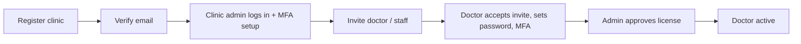
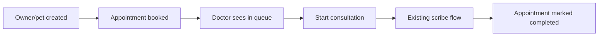
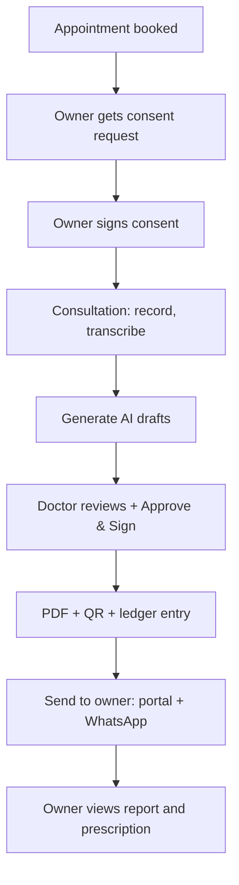

# PetCare AI — Platform Implementation Plan

From a single-clinic AI scribe to a multi-tenant veterinary SaaS with Doctor, Pet Owner, Clinic Admin, Front Desk and Super Admin portals.

---

## 0. Guiding Decisions

| Decision | Choice | Reason |
|:---|:---|:---|
| App structure | **One frontend app, role-based routing** (`/doctor`, `/owner`, `/admin`, `/desk`, `/superadmin`) | One codebase, one design system, one deploy |
| Backend | Keep Express modular monolith | Add modules, don't rewrite |
| Tenancy | **Shared DB, `clinic_id` on every tenant table** + PostgreSQL Row-Level Security | Cheapest, safe if enforced in DB, not only in code |
| Auth | Email+password, phone OTP (owners), JWT access + refresh in httpOnly cookies, TOTP MFA for staff | Standard, secure for medical data |
| Jobs / queues | BullMQ + Redis | Reminders, notifications, PDF, retention purge |
| File storage | S3-compatible object storage (not BYTEA) | Audio, PDFs, attachments; encrypted at rest |
| Notifications | Email (SES/Resend), SMS (MSG91/Twilio), WhatsApp (Cloud API / Gupshup), Web Push | India-first channels |
| Rollout | Feature flags per clinic | Safe gradual release |

### Roles (RBAC)

| Role | Scope |
|:---|:---|
| `super_admin` | Platform-wide, no clinical data by default |
| `clinic_admin` | One clinic: staff, settings, billing, audit |
| `doctor` | Own consultations + clinic patients |
| `staff` | Front desk / nurse / pharmacy / lab tech (sub-roles via permissions) |
| `pet_owner` | Only own pets and own records |

### Golden Rules (never break)

1. Every query is tenant-scoped. No exceptions.
2. Identity comes from the JWT, never from request headers.
3. Every sensitive action writes to the audit ledger.
4. AI output is always a draft until a doctor signs.
5. Each phase ships behind feature flags with automated tests before the next begins.

---

## Timeline Overview

| Phase | Name | Duration (2-3 devs) | Outcome |
|:---:|:---|:---:|:---|
| 1 | Identity, RBAC, Multi-tenancy | 3-4 wks | Secure login, clinics, roles, no spoofing |
| 2 | Clinic Admin + Registry + Scheduling | 3 wks | Clinic can run itself: staff, pets, owners, appointments |
| 3 | Owner Portal v1 + Documents + Notifications | 4 wks | Owners sign consent, receive signed PDFs |
| 4 | Retention Engine | 4 wks | Reminders, vaccines, adherence, history, multilingual |
| 5 | Business Layer | 4 wks | Billing, subscriptions, Super Admin, metering |
| 6 | Operations | 3-4 wks | Front desk, pharmacy, lab, analytics |
| 7 | Advanced | 4+ wks | Teleconsult, pre-visit intake, insurance export |

Total to a sellable product (Phases 1-5): roughly **4-5 months**.

---

# PHASE 1 — Identity, RBAC & Multi-Tenancy

**Goal:** Nobody can access anything without an authenticated identity, and no clinic can see another clinic's data.

## 1.1 Database Migrations

```sql
-- Tenancy
clinics(id, name, slug, status, plan_id, timezone, locale, created_at)

-- Identity
users  -- ALTER: add clinic_id (nullable for super_admin), email_verified_at,
       --        phone, phone_verified_at, status, license_number, license_verified_at,
       --        signature_image_key, last_login_at
user_credentials(user_id PK, password_hash, password_changed_at, failed_attempts, locked_until)
refresh_tokens(id, user_id, token_hash, device_info, ip, expires_at, revoked_at, created_at)
mfa_secrets(user_id PK, secret_encrypted, enabled_at, recovery_codes_hash[])
otp_codes(id, target, purpose, code_hash, expires_at, attempts, consumed_at)
invitations(id, clinic_id, email, role, token_hash, invited_by, expires_at, accepted_at)
password_resets(id, user_id, token_hash, expires_at, used_at)

-- Add clinic_id to ALL existing tenant tables:
-- pets, appointments, consultations, transcript_segments, consultation_audio,
-- consultation_audio_chunks, clinical_extractions, consultation_documents,
-- document_versions, document_approvals, consultation_audit_ledger,
-- recording_consents, audio_retention_policies
```

- Backfill: create one default clinic ("Central Valley Animal Hospital"), assign all existing rows to it.
- Make `clinic_id NOT NULL` after backfill; add composite indexes `(clinic_id, ...)`.
- Enable **Row-Level Security**: set `app.clinic_id` per request via `SET LOCAL`, policy `clinic_id = current_setting('app.clinic_id')::int`.
- **Audit ledger chain per clinic:** hash chain scoped to `(clinic_id)` so tenants are independent.

## 1.2 Backend Modules

```
backend/src/modules/
  auth/        # signup, login, logout, refresh, otp, reset, verify-email
  mfa/         # TOTP enroll/verify/recovery
  rbac/        # role + permission definitions, middleware
  tenancy/     # clinic context middleware, RLS session setter
  invitations/ # create/accept
  sessions/    # list/revoke devices
```

### Middleware chain

```
request → rateLimit → authenticate(JWT cookie) → loadUser → tenantContext(clinic_id → RLS)
        → authorize(permission) → controller
```

### Endpoints

| Method | Endpoint | Notes |
|:---|:---|:---|
| POST | `/auth/register-clinic` | Creates clinic + first `clinic_admin` (trial) |
| POST | `/auth/login` | Email+password; returns MFA challenge if enabled |
| POST | `/auth/mfa/verify` | TOTP code completes login |
| POST | `/auth/otp/request` · `/auth/otp/verify` | Phone OTP (owners) |
| POST | `/auth/refresh` | Rotating refresh token (reuse detection) |
| POST | `/auth/logout` · `/auth/logout-all` | Revoke one / all sessions |
| POST | `/auth/forgot-password` · `/auth/reset-password` | Expiring single-use token |
| GET | `/auth/verify-email?token=` | Email verification |
| POST | `/invitations` | Clinic admin invites staff/doctor |
| POST | `/invitations/:token/accept` | Sets password, joins clinic |
| GET | `/me` · `/me/sessions` | Profile, active sessions |

## 1.3 Security Implementation Checklist

- [ ] argon2id password hashing; min length 10; breached-password check (HIBP k-anonymity)
- [ ] Access token 15 min, refresh 14 days, rotation + reuse detection (revoke family on reuse)
- [ ] Cookies: `httpOnly`, `Secure`, `SameSite=Lax`; CSRF token for mutating requests
- [ ] Rate limit: 5 login attempts / 15 min per account+IP; lockout with exponential backoff
- [ ] MFA mandatory for `doctor`, `clinic_admin`, `super_admin`
- [ ] OTP: 6 digits, 5 min expiry, max 5 attempts, 60 s resend cooldown
- [ ] Helmet, strict CORS allowlist, request size limits
- [ ] Secrets in env/secret manager; PII columns encrypted (pgcrypto or app-level)
- [ ] Doctor accounts start `pending_verification` until clinic admin approves license

## 1.4 Remove Header Trust (critical)

Replace every `x-doctor-id` usage:

```js
// BEFORE
const doctorId = req.headers['x-doctor-id'];
// AFTER
const doctorId = req.user.id;      // from verified JWT
const clinicId = req.user.clinicId;
```

Audit ledger events now store `actor_user_id`, `actor_role`, `ip`, `user_agent`.

## 1.5 Frontend

```
frontend/src/
  auth/        # LoginPage, SignupClinicPage, AcceptInvitePage, ForgotPassword, MfaSetup, OtpLogin
  routes/      # ProtectedRoute, RoleRoute, role→home redirect
  shell/       # RoleAwareLayout, Navbar, ProfileMenu
  api/client.js# fetch wrapper: credentials include, silent refresh on 401
```

- Post-login redirect by role: doctor → `/doctor`, owner → `/owner`, admin → `/admin`.
- Move existing consultation workspace under `/doctor/consultations/:id`.

## 1.6 Tests (must pass to exit phase)

- Cross-tenant access test suite: user of clinic A requests every endpoint with clinic B IDs → all `403/404`.
- Role matrix test: each role × each endpoint.
- Refresh-token reuse, lockout, OTP brute force, expired invite.
- WebSocket auth: reject unauthenticated connection; verify user may access that consultation.

## 1.7 Exit Criteria

- [ ] `x-doctor-id` fully removed
- [ ] RLS enabled and verified on all tenant tables
- [ ] Signup → verify → login → MFA → logout flow works end to end
- [ ] Existing consultation flow still works for authenticated doctor

### Flow



---

# PHASE 2 — Clinic Admin, Registry & Scheduling

**Goal:** A clinic can manage staff, pets, owners and appointments without developer help.

## 2.1 Database

```sql
owners(id, clinic_id, name, phone, email, address, preferred_language, user_id NULL, created_at)
pet_owners(pet_id, owner_id, is_primary, PRIMARY KEY(pet_id, owner_id))
-- pets: ADD species, breed, sex, dob, microchip_no, allergies jsonb, chronic_conditions jsonb, photo_key
clinic_settings(clinic_id PK, letterhead_key, logo_key, address, phone, gstin,
                working_hours jsonb, default_language, audio_retention_days)
doctor_availability(id, clinic_id, doctor_id, weekday, start_time, end_time, slot_minutes)
appointments -- ADD: type, duration_min, source ('owner'|'desk'|'doctor'), cancelled_reason
audit_events -- general (non-clinical) audit: login, view, export, role change
```

## 2.2 Backend

| Module | Endpoints (examples) |
|:---|:---|
| `staff` | `GET/PATCH/DELETE /staff`, `POST /staff/:id/deactivate`, `/staff/:id/approve-license` |
| `owners` | CRUD + search by phone/email, merge duplicates |
| `pets` | CRUD, link/unlink owner, upload photo, allergy + chronic conditions |
| `scheduling` | `GET /availability`, `POST/PATCH/DELETE /appointments`, `GET /calendar?from&to&doctorId` |
| `clinic-settings` | letterhead, hours, retention |
| `audit-viewer` | `GET /audit?filters`, `GET /audit/verify-chain`, `GET /audit/export.csv` |

Scheduling rules: prevent double booking per doctor; respect availability and buffer; timezone-aware (store UTC, render clinic tz).

## 2.3 Doctor Portal Upgrades

- **Today's queue:** appointments list with "Start consultation" (creates consultation linked to appointment, pre-selects pet).
- **Patient banner** inside consultation: name, age, weight, allergies, chronic conditions.
- **Patient history timeline:** past consultations, diagnoses, prescriptions, vitals.

## 2.4 Clinic Admin Portal Pages

`Dashboard` · `Staff` · `Owners & Pets` · `Calendar` · `Settings` · `Audit Log (+ Verify Integrity)`

## 2.5 Exit Criteria

- [ ] Admin invites doctor, doctor sees assigned appointments
- [ ] Appointment → consultation link works both directions
- [ ] Audit verify-chain button returns valid / tampered result per clinic
- [ ] Allergy data appears in consultation banner

### Flow



---

# PHASE 3 — Owner Portal v1, Documents & Notifications

**Goal:** Close the loop — owner consents digitally and receives signed, verifiable reports.

## 3.1 Database

```sql
consent_templates(id, clinic_id, version, type, body_md, language, active)
recording_consents -- ALTER: template_id, template_version, signed_by_owner_id,
                   --        signature_image_key, ip, user_agent, signed_at, revoked_at
generated_files(id, clinic_id, consultation_id, doc_id, type, storage_key, sha256, ledger_hash, created_at)
notifications(id, clinic_id, user_id|owner_id, channel, template, payload jsonb,
              status, provider_id, scheduled_at, sent_at, error)
notification_preferences(owner_id, channel, enabled, quiet_hours)
share_links(id, doc_id, token_hash, expires_at, accessed_count)
```

## 3.2 Owner Portal v1

| Page | Function |
|:---|:---|
| Sign up / OTP login | Phone-first; auto-link to existing `owners` row by phone/email match after verification |
| My Pets | List, profile, add pet |
| Consent | Pre-visit digital signature (typed name + drawn signature, versioned template) |
| Visit Reports | Plain-language summary + home care instructions |
| Prescriptions | View/download signed PDF |
| Appointments | Book, reschedule, cancel |
| Notifications | Preferences |

**Consent flow change:** consultation `start` requires either an owner-signed consent record *or* doctor-attested in-person consent (logged differently in ledger).

## 3.3 Signed PDF Pipeline

1. On **Approve & Sign**, enqueue `generate-pdf` job.
2. Render HTML → PDF (Playwright/Puppeteer) with: clinic letterhead, pet/owner block, document body, doctor name + license no. + signature image, timestamp.
3. Compute SHA-256 of the PDF, store in `generated_files`, append to the audit ledger (`document_pdf_issued`).
4. Embed **QR code** → `https://app/verify/:ledgerHash`.
5. Public **verification page** (no login): shows document type, clinic, doctor, signed time, and "matches ledger ✓ / tampered ✗" without exposing PHI beyond pet name + date.

## 3.4 Notification Service

- Provider abstraction: `send({channel, to, template, vars, lang})`.
- Queue with retries, idempotency keys, delivery status webhooks.
- Templates per language (en, hi, ta to start).
- Triggers this phase: appointment confirmation, reminder (24h / 2h), documents ready, consent request.

## 3.5 Send-to-Owner Action

Doctor clicks **Send to owner** after signing → owner portal notification + WhatsApp/SMS link (secure expiring link or login-required).

## 3.6 Exit Criteria

- [ ] Owner signs consent on phone; consultation starts using it
- [ ] Approved docs generate PDF with signature + QR; QR verifies publicly
- [ ] Owner receives WhatsApp/SMS and can open reports
- [ ] Owner cannot access any pet not linked to them (tested)

### Flow



---

# PHASE 4 — Retention Engine

**Goal:** Make owners come back and improve outcomes.

## 4.1 Database

```sql
medication_schedules(id, clinic_id, pet_id, prescription_doc_id, drug, dose, route,
                     times jsonb, start_date, end_date, instructions)
dose_logs(id, schedule_id, due_at, given_at, status ('given'|'missed'|'skipped'), logged_by)
vaccinations(id, clinic_id, pet_id, vaccine, given_on, due_on, batch_no, administered_by)
vaccine_protocols(id, species, vaccine, start_age_weeks, interval_days, booster_rules jsonb)
vitals(id, clinic_id, pet_id, consultation_id, weight_kg, temp_c, hr, rr, recorded_at)
followups(id, clinic_id, consultation_id, suggested_date, reason, status, appointment_id)
symptom_checkins(id, pet_id, followup_id, responses jsonb, photos[], created_at)
translations_cache(doc_id, language, content jsonb, model, created_at)
```

## 4.2 Medication Adherence Loop

1. Doctor signs prescription.
2. **Parser:** structured Rx lines → `medication_schedules` (use the already-extracted frequency/duration; doctor can adjust before sending).
3. Scheduler creates dose events; reminders sent at due times.
4. Owner taps **Given** → `dose_logs`.
5. Missed-dose escalation (second reminder, then flag to clinic).
6. Doctor/admin sees compliance %; low compliance triggers a follow-up suggestion.

## 4.3 Vaccination & Preventive Care

- Protocol table by species and age; engine computes due dates from `dob` + history.
- Reminder campaigns (30/7/1 days before due).
- One-tap "Book vaccination" from reminder.

## 4.4 Longitudinal Patient Memory (AI)

Extend the prompt builder with a **patient context block**:

```
Known allergies: …
Chronic conditions: …
Last 3 visits: date – diagnosis – meds
Weight trend: 12.4kg (Mar) → 11.2kg (now)
Active medications: …
```

- Safety engine checks **new** Rx against allergies and active meds (interaction rules).
- AI "missing info" list includes changes vs. history.
- Strict token budget; summarize old visits into a rolling patient summary.

## 4.5 Dose Calculator & Safety Engine v2

- mg/kg ranges per drug/species in a managed formulary table (not just JSON file).
- Flags: overdose, underdose, species toxicity, breed sensitivity (MDR1), pregnancy/lactation.
- Hard stops require doctor override with reason (logged to ledger).

## 4.6 Multilingual Owner Instructions

- Consultation language can be Hindi/Tamil (Whisper supports them); records stay in English.
- After signing, generate **owner-friendly instructions** in `owners.preferred_language` via the LLM; cache in `translations_cache`.
- Doctor previews/edits before sending; clearly labeled "AI-translated".
- Evaluate quality with bilingual reviewers before enabling per language.

## 4.7 Follow-ups

AI proposes a follow-up date from the plan → doctor confirms → appointment auto-created → post-visit check-in ("How is Bruno today?") at day 2-3.

## 4.8 Exit Criteria

- [ ] Signed Rx produces a reminder schedule; owner taps log doses; doctor sees adherence
- [ ] Vaccine reminders fire correctly for test pets of different species/ages
- [ ] AI extraction uses history and flags an allergy conflict in a seeded test
- [ ] Tamil/Hindi instructions generated and reviewed

---

# PHASE 5 — Business Layer

**Goal:** Charge money and control cost.

## 5.1 Clinic-Side Billing

```sql
services(id, clinic_id, name, price, tax_rate, category)
invoices(id, clinic_id, owner_id, pet_id, consultation_id, number, status, subtotal, tax, total, due_at)
invoice_items(id, invoice_id, description, qty, unit_price, tax_rate, ref_type, ref_id)
payments(id, invoice_id, method, amount, provider_ref, paid_at)
```

- Auto-draft invoice from consultation (fee + prescribed meds + labs); front desk finalizes.
- GST-compliant numbering and PDF; payment links (Razorpay/Stripe) for owners.

## 5.2 SaaS Subscription Billing

```sql
plans(id, name, price_monthly, included_audio_minutes, included_llm_tokens, max_doctors, features jsonb)
subscriptions(id, clinic_id, plan_id, status, trial_ends_at, current_period_end, provider_sub_id)
usage_events(id, clinic_id, consultation_id, type ('whisper_seconds'|'llm_in'|'llm_out'|'sms'|'wa'|'storage_mb'),
             quantity, unit_cost, model, created_at)
feature_flags(key, clinic_id NULL, enabled, rollout_pct)
```

- **Instrument every Whisper, LLM, SMS and WhatsApp call** with a `usage_events` insert (wrap clients centrally).
- Enforce limits: soft warning at 80%, hard stop or overage at 100%.
- Trial flow: 14 days, limited consultations, upgrade prompts.
- Webhooks from payment provider update `subscriptions` (idempotent).

## 5.3 Super Admin Portal

| Page | Content |
|:---|:---|
| Clinics | Create, suspend, delete (soft), plan change |
| Subscriptions | MRR, trials, churn, failed payments |
| Usage & AI Cost | Per clinic / consultation / model; margin view |
| System Health | Error rates, Groq 429/503 and failover counts, queue depth, latency |
| Feature Flags | Per-clinic toggles |
| Formulary Manager | Edit aliases, contraindications, dose ranges (versioned, reviewed) |
| Model Settings | Primary/failover model, prompt versions, A/B tests |
| Support | Audited "impersonate user" with time-boxed session + banner + ledger entry |

Super admin must **not** see PHI by default; impersonation requires reason and is visible to the clinic admin in their audit log.

## 5.4 Exit Criteria

- [ ] New clinic can sign up, trial, subscribe, and be limited by plan
- [ ] Usage events reconcile with provider invoices within tolerance
- [ ] Invoice generated from consultation and paid online
- [ ] Super admin can suspend a clinic and logins are blocked immediately

---

# PHASE 6 — Operations

**Goal:** Run the whole clinic floor.

## 6.1 Front Desk / Staff Portal

- Walk-in registration, quick check-in, token queue + waiting-room display screen.
- Billing counter and receipt printing.
- **Vet nurse mode:** record vitals before the doctor; values prefill the Summary.

## 6.2 Pharmacy & Inventory

```sql
inventory_items(id, clinic_id, name, sku, unit, stock, reorder_level, cost, price, expiry)
stock_movements(id, item_id, type, qty, ref_type, ref_id, created_at)
dispensing(id, prescription_doc_id, item_id, qty, dispensed_by, dispensed_at, status)
```

- Signed Rx appears in the pharmacy queue; dispense deducts stock and adds to the invoice.
- Low-stock and expiry alerts.

## 6.3 Lab Workflow

```sql
lab_orders(id, clinic_id, consultation_id, tests jsonb, status, external_lab_id)
lab_samples(id, order_id, barcode, collected_at, sent_at, received_at)
lab_results(id, order_id, values jsonb, file_key, reviewed_by, released_at)
```

- Convert **Formally Ordered** tests from the Lab Tests doc into `lab_orders`.
- Status pipeline: ordered → collected → sent → resulted → reviewed → released to owner.
- Owner sees results with plain-language explanation (AI draft, doctor-approved).

## 6.4 Analytics Dashboard

Consultations/day, documentation time saved, **AI edit rate** (diff between draft and signed), top diagnoses, revenue, no-show rate, adherence, vaccine compliance.

## 6.5 Attachments

Photos, X-rays, lab PDFs attached to consultations (`attachments` table, object storage, virus scan, size/type limits).

## 6.6 Exit Criteria

- [ ] Walk-in → vitals → consultation → Rx → dispense → invoice → payment works as one flow
- [ ] Stock deducts correctly and alerts fire
- [ ] Lab order goes through full status pipeline

---

# PHASE 7 — Advanced

| Feature | Notes |
|:---|:---|
| Pre-visit smart intake | Owner form/voice note → AI pre-fills Summary draft (marked "owner-reported") |
| Async chat with clinic | Threads per pet, attachments, read receipts; video later (Daily/Twilio) |
| Teleconsultation | Reuse recording + scribe pipeline for remote visits; jurisdiction compliance check |
| Insurance claim export | One-click PDF bundle: summary, invoice, labs |
| Health records vault | Owner uploads old records; expiring vet-to-vet share link |
| Voice dictation editing | Doctor edits docs by voice |
| Mobile apps | PWA first; native wrapper only if push/UX demands |

---

# Cross-Cutting Workstreams (run through all phases)

## A. Audit Ledger Expansion

Add events: `login`, `login_failed`, `mfa_enrolled`, `document_viewed`, `document_exported`, `pdf_issued`, `consent_signed`, `role_changed`, `impersonation_started`, `data_exported`, `data_deleted`. Per-clinic chain; nightly integrity job with alerting.

## B. Privacy & Compliance

- DPDP Act 2023 (India) and GDPR (if EU): explicit versioned consent, purpose limitation, right to access/erasure workflow, breach notification runbook, DPA with clinics.
- Retention worker: purge audio per policy; keep signed text record.
- Encrypt at rest (DB volume + object storage + sensitive columns); TLS everywhere.
- Backups encrypted, tested restores monthly, region-pinned storage.
- Vendor review: Groq, SMS/WhatsApp providers, payment gateways (data location, DPA).

## C. Reliability & Ops

- Environments: dev / staging / prod; migrations via CI with rollback plan.
- Observability: structured logs, Sentry, metrics, uptime checks, alerting on queue backlog and AI failure rate.
- Rate limits and per-clinic concurrency caps for Whisper/LLM.
- Load test the audio pipeline before onboarding multiple clinics.

## D. Testing Strategy

| Layer | Tools |
|:---|:---|
| Unit | `node --test` (existing) |
| Integration | API + real Postgres with RLS |
| Security | Cross-tenant suite, RBAC matrix, OWASP ZAP in CI |
| E2E | Playwright per role (existing virtual mic setup) |
| AI quality | Golden transcripts → expected extraction; track edit-rate and hallucination reviews |

## E. AI Quality Loop

- Store `ai_draft` vs `signed` diff; compute edit rate per field.
- Doctor "report issue" button on drafts → review queue for prompt/formulary improvements.
- Version prompts; roll out changes via feature flags and A/B.

---

# Suggested Repo Structure (target)

```
backend/src/modules/
  auth/ mfa/ rbac/ tenancy/ invitations/ sessions/
  clinics/ staff/ owners/ pets/ scheduling/ clinic-settings/
  audio/ transcription/ clinical-ai/ consultations/ documents/ templates/ audit/
  pdf/ notifications/ consents/ share-links/
  medications/ vaccinations/ followups/ translation/
  billing/ subscriptions/ usage/ feature-flags/ superadmin/
  inventory/ lab/ analytics/ attachments/ chat/
  jobs/            # BullMQ workers
frontend/src/features/
  auth/ doctor/ owner/ admin/ desk/ superadmin/ shared/
```

---

# Risk Register

| Risk | Impact | Mitigation |
|:---|:---|:---|
| Tenant data leak | Critical | RLS + cross-tenant CI tests + code review rule |
| AI hallucination in Rx | Critical | Human sign-off, safety engine, dose limits, edit tracking |
| LLM/Whisper cost overrun | High | Usage metering, plan caps, decoupled generation (already built) |
| WhatsApp template approval delays | Medium | Start approval early; SMS/email fallback |
| Regional language quality | Medium | Human review, doctor preview, "AI-translated" label |
| Scope creep | High | Strict phase exit criteria; feature flags; ship Phase 1-3 to pilot clinic first |
| Single-vendor dependency (Groq) | Medium | Keep failover chain; abstract provider interface |

---

# Definition of Done (per feature)

1. Migration + rollback script
2. RBAC + tenant checks + tests
3. Audit ledger events where applicable
4. Usage metering where it costs money
5. Feature flag
6. Unit + integration + E2E coverage
7. Docs updated (README + API reference)
8. Reviewed on staging with a pilot clinic user

---

# Immediate Next Steps (Week 1)

1. Decide: India-only or global (affects DPDP/GDPR, payment and messaging providers).
2. Provision Redis, object storage, staging environment.
3. Write Phase 1 migration: `clinics`, `clinic_id` backfill, credentials, tokens.
4. Build auth module + middleware chain; replace `x-doctor-id`.
5. Add RLS and the cross-tenant test suite **before** any new feature.
6. Build login/signup UI and role-based routing shell.

