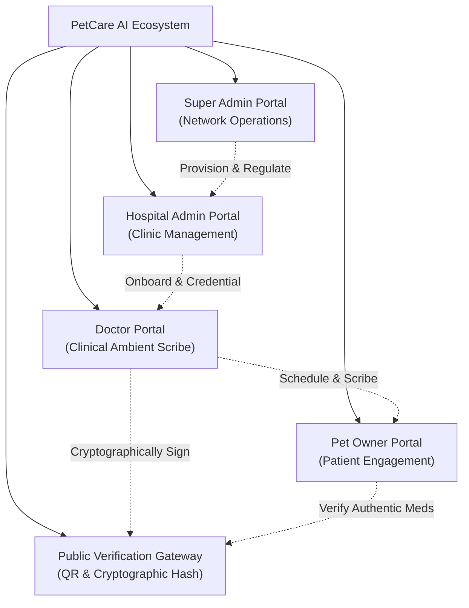
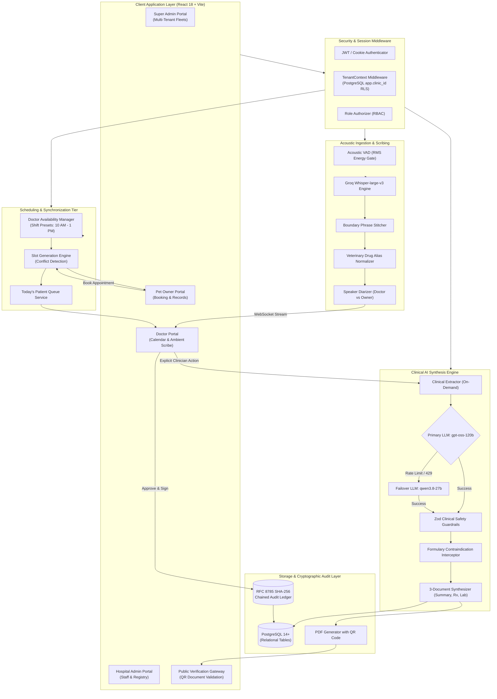

# 🏥 PetCare AI — Enterprise Veterinary Clinical Ambient Scribe & Hospital OS

[](https://github.com)
[](https://groq.com)
[](https://groq.com)
[](https://github.com)
[](https://github.com)

**PetCare AI** is an enterprise multi-tenant clinical intelligence and hospital operating platform built for veterinary networks, animal hospitals, and pet guardians. The platform captures spoken doctor-client consultations in real time, isolates vocal audio with acoustic Voice Activity Detection (VAD), transcribes dialogue using **OpenAI Whisper-large-v3**, normalizes veterinary pharmacology, extracts structured medical findings with **Groq LLM (`openai/gpt-oss-120b`)**, and drafts **3 core clinical documents** (**Summary**, **Prescription**, and **Lab Tests**) — all governed by an explicit human-in-the-loop review workflow, a tamper-evident cryptographic audit ledger, and four role-isolated portals.

---

## 📑 Table of Contents

1. [Executive Summary & Problem Solved](#-executive-summary--problem-solved)
2. [The 4 Unified SaaS Portals](#-the-4-unified-saas-portals)
3. [Key Features & Recent Platform Enhancements](#-key-features--recent-platform-enhancements)
4. [System Architecture](#-system-architecture)
5. [End-to-End Workflow Explained](#-end-to-end-workflow-explained)
6. [The Realigned 3-Document Model](#-the-realigned-3-document-model)
7. [Doctor Availability & Patient Booking Synchronization](#-doctor-availability--patient-booking-synchronization)
8. [Session Isolation & Multi-Tenant Data Security](#-session-isolation--multi-tenant-data-security)
9. [Tech Stack](#-tech-stack)
10. [Project Directory Layout](#-project-directory-layout)
11. [Prerequisites & Environment Setup](#-prerequisites--environment-setup)
12. [Quick Start Guide](#-quick-start-guide)
13. [Testing & Quality Verification](#-testing--quality-verification)
14. [Database Schema Reference](#-database-schema-reference)
15. [REST API & Real-Time WebSocket Reference](#-rest-api--real-time-websocket-reference)
16. [Frequently Asked Questions (FAQ)](#-frequently-asked-questions-faq)

---

## 💡 Executive Summary & Problem Solved

### The Veterinary Problem
Veterinarians spend **2 to 3 hours every day** manually typing consultation records, SOAP notes, and prescription orders after clinical hours. This administrative burden causes:
- **Clinician Burnout**: High cognitive fatigue and extended uncompensated evening documentation.
- **Documentation Gaps**: Rushed notes often omit subtle symptoms, dosage timings, or owner compliance advice.
- **Impaired Client Focus**: Looking at computer screens during consultations detracts from physical examinations and client connection.
- **Data Fragmentation**: Hospitals struggle with disconnected systems for scheduling, live consultations, pet owner records, and audit compliance.

### The PetCare AI Solution
PetCare AI serves as an ambient co-pilot and comprehensive veterinary operating system:
1. **Listens Passively**: Captures conversations via browser microphone or pre-recorded consultations.
2. **Understands Veterinary Nuance**: Distinguishes between doctor instructions and owner reports, normalizing specialized veterinary drug pharmacology (e.g., *Clavamox, Apoquel, Cerenia*).
3. **Drafts Instant Records**: Automatically constructs formatted Medical Summaries, ready-to-dispense Prescriptions, and Diagnostic Lab requisitions.
4. **Guarantees Clinician Oversight**: AI drafts remain pending until the attending veterinarian reviews, edits, and clicks **Approve & Sign All** or **Reject AI Draft**.
5. **Maintains Medical-Legal Compliance**: Every revision, approval, and rejection is permanently recorded in a SHA-256 cryptographically chained audit ledger with public QR verification.
6. **Unifies All Hospital Stakeholders**: Delivers dedicated, role-tailored portals for Network Super Admins, Hospital Admins, Attending Veterinarians, and Pet Guardians.

---

## 🌐 The 4 Unified SaaS Portals

PetCare AI provides complete multi-tenant role segregation across four distinct user experiences and an open public verification engine:



### 1. 🛡️ Super Admin Portal (`?portal=super-admin`)
Built for multi-clinic veterinary networks, enterprise franchises, and platform regulators:
- **Tenant Fleet Management**: Provision new veterinary hospitals, activate/suspend practice branches, and configure clinic licensing.
- **Network SLA & Scribe Velocity Visualizer**: Real-time 14-day consultation volume telemetry, AI scribe processing latency metrics, and API health monitors.
- **Multi-Tenant Segregation**: Strict schema-level and tenant-context boundaries preventing cross-hospital data exposure.
- **Platform-Wide Audit Viewer**: Inspect global security events, administrative logins, and credential provisioning.

### 2. 🏥 Hospital Admin Portal (`?portal=admin`)
Designed for practice managers, clinic directors, and administrative supervisors:
- **Veterinarian Onboarding & Credentialing**: Register attending doctors with veterinary license verification (`VET-CA-123`), clinical specialties, and system permissions.
- **Staff & Clinical Directory**: Manage hospital veterinarians, vet technicians, and front-desk staff with active consultation deletion guards.
- **Patient & Guardian Registry**: Comprehensive database of enrolled animals, breeds, microchips, and pet owners.
- **Practice Settings & Operating Hours**: Configure practice hours, consultation fees, and emergency contact channels.
- **Hospital Audit Log**: Full visibility into booking adjustments, patient registry changes, and administrative actions.

### 3. 🩺 Doctor / Veterinarian Portal (`?portal=doctor`)
The core clinical engine for attending veterinarians (DVMs):
- **Practice Dashboard**: Daily appointment agenda, patient queue, and clinical velocity statistics.
- **Dedicated Appointment Schedule**: 
  - Dedicated left-sidebar navigation item.
  - **Today's Patient Queue Cards**: Quick-action cards showing appointment times, patient species/breed, guardian contacts, and clinical visit reasons.
  - **1-Click Live Consultation Switcher**: Seamlessly transitions the clinician directly to the Live Audio Consultation workspace for that patient.
  - **Searchable Roster & Server-Side Pagination**: Full-history booking search with status filtering.
- **Live Consultation & AI Scribe Workspace**:
  - Ambient audio capture with real-time CSS waveform visualizer and high-precision timer.
  - Live diarized speech stream with 1-click speaker role toggling (**Doctor** vs. **Owner**).
  - Decoupled AI synthesis: transcribe first, generate structured medical drafts only when requested.
  - **3 Core Clinical Documents**: Narrative Medical Summary, Dispensing Prescription, Diagnostic Lab Tests.
  - **Clinical Insights Modal**: Single-view case review with **Approve & Sign All** (batch signing) and **Reject AI Draft** (with audit reason).
- **Doctor Calendar & Slot Availability**:
  - Tokenized `.segmented-tab-bar` switcher for **Available Slots** vs. **Appointment List**.
  - **Interactive Working Shift Configurator**: 1-click presets for **Morning Shift (10:00 AM – 01:00 PM)**, **Full Day (09:00 AM – 05:00 PM)**, **Afternoon (02:00 PM – 06:00 PM)**, and **Custom Hours**.
  - Direct persistence to PostgreSQL `doctor_availability` table with audit logging.
  - Interactive slot cards showing formatted 12-hour times (`10:00 AM`), live booking statuses, and patient details.
- **Patient Clinical Charts**: Timeline of past consultations, active allergy badges, chronics, and treatment logs.
- **Patient Registration**: Direct animal enrollment modal.
- **Doctor Settings**: Manage DVM profile, veterinary license numbers, acoustic Whisper speech preferences, and password security.

### 4. 🐾 Pet Owner / Guardian Portal (`?portal=owner`)
Empowering pet parents to participate in their animal's care:
- **Clinical Affiliation**: Connect to accredited veterinary hospitals and select verified attending veterinarians.
- **Real-Time Appointment Booking**: 
  - Real-time synchronization with doctor-confirmed availability blocks (e.g., viewing only the open slots between 10:00 AM and 1:00 PM when a doctor is on morning shift).
  - Select registered pet, specify primary visit reason, and receive instant confirmation.
- **Digital Recording & Procedure Consent**: Pet parents review and cryptographically sign recording consent before ambient transcription begins.
- **Medical Records & Prescriptions**: View approved consultation summaries, medication regimens, dosage instructions, and lab requisitions.
- **Downloadable Sealed PDFs**: One-click PDF export containing SHA-256 cryptographic hashes and verification QR codes.
- **Pet Health Profiles**: Manage companion vitals, microchip IDs, and emergency contacts.

### 5. 🔍 Public Cryptographic Verification Gateway (`/verify`)
Publicly accessible portal allowing pharmacies, referral hospitals, and guardians to verify clinical documentation authenticity:
- Inspect document integrity by scanning the QR code on any exported prescription or summary PDF.
- Validates the RFC 8785 canonical SHA-256 hash against the tamper-evident ledger, verifying that the document was signed by a licensed veterinarian and has not been altered.

---

## ⚡ Key Features & Recent Platform Enhancements

| Feature | Category | Description & Impact |
|:---|:---:|:---|
| **Doctor Session Isolation** | *Security & Compliance* | Complete cross-doctor data isolation. Unscoped `localStorage` keys and URL consultation query params are automatically purged on login and logout. Backend document endpoints enforce strict tenant and clinician ownership checks. |
| **Synchronized Slot Availability** | *Scheduling Engine* | Doctors define practice shifts (e.g., Morning Shift: 10:00 AM – 1:00 PM) in their calendar. The scheduling engine persists hours to PostgreSQL and automatically restricts booking slots in the Pet Owner Portal to match. |
| **Dedicated Appointment Schedule** | *Clinician UX* | Moved the appointment queue out of the live consultation view to a dedicated sidebar navigation view. Features today's queue cards, roster search, and 1-click consultation launching. |
| **Decoupled Transcription & Synthesis** | *AI Workflow* | Audio transcription and LLM document synthesis are decoupled. Clinicians can review raw transcripts and sound quality before triggering Groq LLM synthesis, reducing unnecessary API costs. |
| **Multi-Model LLM Failover** | *Reliability* | Primary extraction uses Groq `openai/gpt-oss-120b`. If rate limits (`429`) or server issues (`503`) occur, the pipeline automatically falls back to `qwen/qwen3.8-27b` without clinician interruption. |
| **Acoustic VAD Energy Gating** | *Audio Pipeline* | 20ms audio frame energy gating (`-42 dB` RMS threshold) trims silence and non-vocal background noise before reaching Whisper, reducing transcription latency by up to 60%. |
| **Veterinary Pharmacology Normalization** | *Clinical Safety* | Formulary dictionary (`drug_aliases.json`) with Levenshtein fuzzy matching standardizes phonetically misheard brand names and intercepts feline contraindications (e.g., Acetaminophen toxicity). |
| **RFC 8785 Cryptographic Audit Ledger** | *Legal Compliance* | Tamper-evident SHA-256 chained block ledger tracking all consultation actions, revisions, approvals, and rejections using RFC 8785 canonical JSON formatting. |
| **Tokenized SaaS Design System** | *Frontend UI* | Strict CSS variable architecture (`theme.css`) with light and dark themes, universal custom scrollbars, and mobile-first responsiveness (360px, 768px, 1280px). |

---

## 🏛️ System Architecture



---

## 🔄 End-to-End Workflow Explained

```
[1. Doctor Shift Setup] ──> [2. Owner Appointment Booking] ──> [3. 1-Click Consultation Launch]
                                                                          │
[6. PDF & QR Verification] <── [5. Clinician Review & Sign] <── [4. Ambient Scribe & AI Draft]
```

1. **Doctor Shift Setup**:
   - The attending veterinarian opens **Calendar & Slots** in the Doctor Portal.
   - Selects **Morning Shift (10:00 AM – 01:00 PM)** (or custom hours) and clicks **Confirm & Save Availability**.
   - The scheduling engine stores the block in the `doctor_availability` table.
2. **Owner Appointment Booking**:
   - The pet owner opens the **Pet Owner Portal**, chooses their affiliated hospital/doctor, and selects the consultation date.
   - The system displays only open slots within the doctor's confirmed shift (e.g., 10:00 AM, 10:15 AM, 10:30 AM).
   - The owner selects their pet, enters the visit reason, and confirms the booking.
3. **1-Click Consultation Launch**:
   - The booking appears immediately in the doctor's **Appointment Schedule** under **Today's Patient Queue**.
   - The clinician clicks **Start Live Consultation**, which automatically loads the patient session and switches to the live workspace.
4. **Ambient Audio Recording & AI Scribe**:
   - Audio is captured through the browser microphone with Voice Activity Detection (VAD) dropping silent frames.
   - Real-time dialogue is transcribed by Whisper-large-v3 and displayed with speaker roles.
   - When the examination concludes, the doctor clicks **Generate AI Drafts** to invoke Groq LLM clinical extraction.
5. **Clinician-in-the-Loop Review & Signing**:
   - The doctor reviews the drafted Summary, Prescription, and Lab Tests in the **Clinical Insights Modal**.
   - The doctor clicks **Approve & Sign All** to lock the documents as immutable legal records.
   - The system chains an RFC 8785 SHA-256 block into the audit ledger.
6. **Digital Distribution & Verification**:
   - The pet owner instantly receives the approved summary and prescription in their portal.
   - Any party can scan the QR code on the PDF or enter the document hash at `/verify` to confirm authenticity.

---

## 📋 The Realigned 3-Document Model

| Tab | Document | Contents & Clinical Structure | Primary Purpose |
|:---:|:---|:---|:---|
| **1** | **Summary** *(Default)* | • Narrative Clinical Overview<br>• Chief Complaints & Symptoms with Duration/Severity<br>• Physical Examination Findings (Vitals, Palpation, Auscultation)<br>• Assessment & Diagnoses (*Confirmed* vs. *Suspected*)<br>• Client Home Care, Dietary & Follow-Up Guidance<br>• Missing Information & Safety Checklist | Complete legal clinical encounter record and client discharge instructions. |
| **2** | **Prescription** | • Prescribed Medication List with Item Numbers<br>• Formulation, Strength, Dosage, and Administration Route<br>• Frequency, Duration, and Doctor Administration Notes<br>• Verbatim Transcript Quote Evidence verifying doctor instruction | Standalone, pharmacy-ready medication order with full clinical audit provenance. |
| **3** | **Lab Tests** | • Recommended Diagnostic Investigations (CBC, Chem 17, Urinalysis)<br>• Test Classification (*Discussed with Owner* vs. *Formally Ordered*)<br>• Clinical Justification & Next-Step Decision Criteria | Diagnostic order requisition for in-house or hospital reference laboratories. |

---

## 🗓️ Doctor Availability & Patient Booking Synchronization

A core feature of the platform is the synchronization between clinician calendar shifts and pet owner booking capabilities:

1. **Shift Presets**:
   - **Morning Shift**: `10:00 AM – 01:00 PM`
   - **Full Day**: `09:00 AM – 05:00 PM`
   - **Afternoon Shift**: `02:00 PM – 06:00 PM`
   - **Custom Hours**: Custom start and end time pickers with slot duration intervals (15, 30, 45, or 60 minutes).
2. **Scope Options**:
   - **Selected Day Only**: Applies the working block to the currently viewed calendar date.
   - **All Weekdays (Mon – Fri)**: Applies recurring availability across the working week.
3. **Real-Time Client Enforcement**:
   - Pet owners visiting the booking portal cannot book slots outside the doctor's confirmed shift window.
   - Once a slot is booked, it instantly updates to `Booked` in the clinician's calendar with patient details and is removed from the owner booking view.

---

## 🔒 Session Isolation & Multi-Tenant Data Security

PetCare AI implements strict session isolation and tenant security measures:

1. **Tenant Context Enforcement**:
   - Every authenticated request includes clinic ID context, setting PostgreSQL session variables (`app.clinic_id`) for row-level segregation.
2. **Document Authorization Guards**:
   - Consultation document endpoints (`/api/v1/consultations/:id/documents` and `/api/v1/consultations/:id/generate`) verify doctor and clinic ownership before returning clinical data, preventing cross-doctor document leakage.
3. **Session Cleansing on Auth Transitions**:
   - Logging in, switching accounts, or logging out completely purges cached consultation IDs (`activeConsultationId_${userId}`), active doctor IDs, and URL query parameters (`?consultationId`).
4. **WebSocket Room Isolation**:
   - Real-time speech streaming is strictly confined to WebSocket rooms keyed by consultation ID. Switching patients aborts pending HTTP requests and severs the prior WebSocket connection.

---

## 🛠️ Tech Stack

### Frontend
- **Framework**: React 18.3 (Strict Mode, Custom Hooks, Functional Components)
- **Tooling**: Vite 6.4 (ESM, Sub-second HMR)
- **Icons**: Lucide React
- **Design System**: Tokenized CSS (`theme.css`) with light/dark palettes, mobile-first media queries (`min-width: 600px` and `1024px`), and custom scrollbars
- **Testing**: Playwright 1.65 (E2E browser automation with virtual microphone injection) & Custom theme token compliance linter

### Backend
- **Runtime**: Node.js 18+ (CommonJS)
- **Framework**: Express.js 4.21
- **Real-Time Transport**: Native WebSocket Server (`ws` 8.18)
- **Schema Validation**: Zod 3.24 (Type-safe request and extraction validation)
- **Audio Processing**: Multer 2.5 with in-memory buffer handling and chunk deduplication
- **PDF Generation**: PDFKit with embedded QR code generation and cryptographic hash stamping
- **Testing**: Native Node.js Test Runner (`node --test`)

### Database & Cryptography
- **Database Engine**: PostgreSQL 14+
- **Driver**: `pg` 8.13 (Connection pooling and transactional rollbacks)
- **Audit Standard**: RFC 8785 Canonical JSON with SHA-256 chained hashing

### AI & Speech Infrastructure
- **Speech-to-Text (STT)**: OpenAI Whisper-large-v3 via Groq API (< 1.2s per 15s chunk)
- **Primary Clinical LLM**: Groq `openai/gpt-oss-120b`
- **Secondary Failover LLM**: Groq `qwen/qwen3.8-27b`

---

## 📂 Project Directory Layout

```text
Voice to transcript/
├── backend/
│   ├── src/
│   │   ├── config/              # Centralized environment config & drug aliases
│   │   ├── db/                  # PostgreSQL connection, schema, and migrations
│   │   │   ├── migrations/      # Sequential SQL migrations (001 - 008)
│   │   │   ├── connection.js    # pg Pool singleton with tenant session variable
│   │   │   └── schema.sql       # Relational table definitions
│   │   ├── middleware/          # Authenticate, authorize (RBAC), and tenantContext
│   │   ├── modules/
│   │   │   ├── audio/           # Audio controller, chunk storage, and validation
│   │   │   ├── audit/           # RFC 8785 SHA-256 chained audit ledger
│   │   │   ├── audit-viewer/    # Multi-tenant audit trail viewer APIs
│   │   │   ├── auth/            # JWT authentication, clinic registration, and MFA
│   │   │   ├── clinic-settings/ # Hospital operating hours & practice configurations
│   │   │   ├── clinical-ai/     # LLM extractor, multi-model failover, and Zod schemas
│   │   │   ├── consultations/   # Consultation lifecycle management
│   │   │   ├── directory/       # Veterinarian and patient directory endpoints
│   │   │   ├── documents/       # Document management, approval, and legal locking
│   │   │   ├── owner-portal/    # Pet owner auth, affiliations, bookings, and records
│   │   │   ├── pdf-generator/   # PDF compilation with QR verification stamps
│   │   │   ├── realtime/        # WebSocket server and consultation room routing
│   │   │   ├── scheduling/      # Slot generation engine, doctor shifts, and today's queue
│   │   │   ├── super-admin/     # Platform fleet management and hospital onboarding
│   │   │   ├── transcription/   # VAD service, boundary stitcher, and Whisper client
│   │   │   └── verify/          # Public cryptographic document verification
│   │   └── server.js            # Express bootstrap and combined HTTP/WS listener
│   └── package.json
│
├── frontend/
│   ├── e2e/                     # Playwright E2E test specs (audio, responsive, onboarding)
│   ├── src/
│   │   ├── api/                 # API clients (apiClient and ownerClient)
│   │   ├── auth/                # AuthContext, login, MFA, and signup flows
│   │   ├── components/common/   # Shared SearchFilterBar, PaginationControl, etc.
│   │   ├── features/
│   │   │   ├── admin/           # Hospital Admin Portal (Dashboard, Staff, Registry, Settings)
│   │   │   ├── consultation/    # Live Consultation Workspace & Document Editor
│   │   │   ├── doctor/          # Doctor Portal (Dashboard, Schedule, Slots, Patients, Charts)
│   │   │   ├── owner/           # Pet Owner Portal (Booking, Affiliation, Records, Consents)
│   │   │   ├── super-admin/     # Super Admin Portal (Hospital Fleet, Analytics, Audits)
│   │   │   └── verify/          # Public Document Verification Page
│   │   ├── styles/              # Design system tokens (theme.css, admin.css, doctor.css, etc.)
│   │   ├── App.jsx              # Role-aware portal router and top-level navigation
│   │   └── main.jsx             # React DOM root
│   ├── playwright.config.js     # Headless Playwright config with virtual microphone
│   └── vite.config.js
│
├── scripts/                     # Theme linters, responsive checkers, and test seeders
├── graphify-out/                # AST Codebase Knowledge Graph (graphify)
└── package.json                 # Monorepo root scripts
```

---

## ⚙️ Prerequisites & Environment Setup

### 1. Prerequisites
- **Node.js**: v18.0.0 or higher
- **PostgreSQL**: v14.0 or higher (running on `localhost:5432`)
- **Groq API Key**: Required for high-speed Whisper-large-v3 and clinical LLM extraction ([Get Groq Key](https://console.groq.com/keys))

### 2. Environment Configuration (`.env`)
Create a `.env` file in the project root:

```ini
# Application Port
PORT=5000
NODE_ENV=development

# PostgreSQL Database
DB_USER=postgres
DB_PASSWORD=your_password
DB_HOST=localhost
DB_PORT=5432
DB_NAME=petcare

# Authentication Secrets
JWT_SECRET=super_secret_jwt_key_change_in_production
JWT_EXPIRES_IN=24h

# Groq High-Speed AI Engine
GROQ_API_KEY=gsk_your_groq_api_key_here
GROQ_WHISPER_MODEL=whisper-large-v3
GROQ_LLM_MODEL=openai/gpt-oss-120b
GROQ_FAILOVER_MODEL=qwen/qwen3.8-27b

# Audio Retention Policy (GDPR/Compliance)
AUDIO_RETENTION_DAYS=30
```

---

## 🚀 Quick Start Guide

### Step 1: Install Dependencies
```bash
npm install
cd backend && npm install
cd ../frontend && npm install
cd ..
```

### Step 2: Initialize Database & Run Migrations
Ensure PostgreSQL is running locally, then execute:
```bash
npm run backend:migrate
```
*This creates the database, applies all 8 schema migrations, sets up relational foreign keys and indexes, and seeds demo hospitals, veterinarians, and patient profiles.*

### Step 3: Start the Backend Server
```bash
npm run backend:dev
```
- REST API: `http://localhost:5000/api/v1`
- WebSocket Server: `ws://localhost:5000/ws/v1/consultations/:id`

### Step 4: Start the Frontend Application
In a separate terminal window:
```bash
npm run frontend:dev
```
Open **`http://localhost:3000`** in your browser.

---

## 🧪 Testing & Quality Verification

PetCare AI maintains strict automated verification standards across all application layers:

### 1. Backend Automated Test Suite
```bash
npm run backend:test
```
Covers:
- Consultation lifecycle and state transitions.
- Multi-tenant data segregation across hospitals.
- Voice Activity Detection (VAD) energy gating and silence trimming.
- Dual-pass transcription and boundary phrase stitching.
- RFC 8785 cryptographic audit ledger chain integrity.
- Zod clinical safety schemas and contraindication interception.

### 2. Frontend Playwright E2E Suite
```bash
cd frontend && npx playwright test
```
Executes cross-browser end-to-end tests covering:
- Live ambient audio capture with virtual microphone stream injection.
- Hospital Admin doctor onboarding flow.
- Doctor calendar shift scheduling and slot selection.
- Pet owner booking and clinical document review.
- Multi-viewport responsive checks (360px mobile, 768px tablet, 1280px desktop).

### 3. Theme Token Compliance Linter
```bash
npm --prefix frontend run lint:theme
```
Verifies that all stylesheets adhere to `UI_GUIDELINES.md`, ensuring zero hardcoded color values and strict CSS variable usage from `theme.css`.

### 4. Knowledge Graph Maintenance
```bash
graphify update .
```
Maintains the codebase knowledge graph (`graphify-out/`), tracking 1,130+ code symbols, dependencies, and architectural communities.

---

## 🗄️ Database Schema Reference

All tables use sequential integer primary keys (`id SERIAL PRIMARY KEY`) for clean routing, predictable foreign key constraints, and indexing.

| Table Name | Primary Key | Foreign Keys | Key Columns | Clinical & Operational Purpose |
|:---|:---|:---|:---|:---|
| `clinics` | `id SERIAL` | None | `name`, `subdomain`, `is_active` | Multi-tenant veterinary hospital records. |
| `users` | `id SERIAL` | `clinic_id` | `name`, `email`, `role`, `license_no` | Attending veterinarians, clinic admins, super admins. |
| `owners` | `id SERIAL` | None | `name`, `email`, `phone`, `password_hash` | Pet owners and animal guardians. |
| `owner_clinic_affiliations` | `id SERIAL` | `owner_id`, `clinic_id`, `doctor_id` | `is_primary`, `status` | Affiliation links connecting guardians to clinics. |
| `pets` | `id SERIAL` | `clinic_id`, `owner_id` | `name`, `species`, `breed`, `weight_kg` | Animal patient records, allergies, and vitals. |
| `doctor_availability` | `id SERIAL` | `clinic_id`, `doctor_id` | `weekday`, `start_time`, `end_time`, `slot_minutes` | Doctor consultation shift hours (e.g. 10 AM - 1 PM). |
| `appointments` | `id SERIAL` | `clinic_id`, `pet_id`, `doctor_id` | `scheduled_at`, `status`, `reason` | Booked clinical appointments and queue entries. |
| `consultations` | `id SERIAL` | `clinic_id`, `pet_id`, `doctor_id` | `status`, `language`, `consent_given` | Active consultation session state and metadata. |
| `transcript_segments` | `id SERIAL` | `consultation_id` | `sequence_number`, `speaker_role`, `text` | Sequential speech transcripts with diarization. |
| `consultation_audio` | `id SERIAL` | `consultation_id (UNIQUE)` | `audio_data (BYTEA)`, `audio_hash` | Raw audio binary for dual-pass verification. |
| `consultation_documents` | `id SERIAL` | `consultation_id` | `doc_type`, `status`, `current_version`, `content (JSONB)` | Generated medical documents (`summary`, `prescription`, `lab_tests`). |
| `document_versions` | `id SERIAL` | `document_id`, `changed_by` | `version_number`, `content (JSONB)`, `doctor_notes` | Complete version history of doctor edits. |
| `document_approvals` | `id SERIAL` | `document_id`, `doctor_id` | `action ('approved' / 'rejected')`, `reason` | Legal sign-off ledger; locks document as immutable. |
| `consultation_audit_ledger` | `id SERIAL` | `consultation_id` | `sequence_number`, `previous_hash`, `current_hash` | RFC 8785 SHA-256 cryptographically chained ledger. |
| `recording_consents` | `id SERIAL` | `consultation_id (UNIQUE)` | `consent_type`, `given_by`, `consent_text` | Explicit recording consent signed by pet owner. |
| `audio_retention_policies` | `id SERIAL` | `consultation_id (UNIQUE)` | `retain_until`, `auto_delete_audio` | Automated GDPR/privacy audio deletion policy. |

---

## 🌐 REST API & Real-Time WebSocket Reference

### Key Endpoint Groups

#### 1. Authentication & Tenancy
- `POST /api/v1/auth/login` — User authentication with MFA support.
- `POST /api/v1/auth/logout` — Session termination and storage cleansing.
- `POST /api/v1/auth/register-clinic` — Hospital tenant registration.
- `GET /api/v1/auth/me` — Authenticated session context check.

#### 2. Consultations & Clinical Scribe
- `POST /api/v1/consultations` — Initialize a patient consultation.
- `GET /api/v1/consultations` — List tenant-scoped consultations.
- `GET /api/v1/consultations/:id` — Retrieve full consultation details.
- `POST /api/v1/consultations/:id/consent` — Record owner recording consent.
- `POST /api/v1/consultations/:id/start` — Start ambient recording session.
- `POST /api/v1/consultations/:id/stop` — Stop recording session.
- `POST /api/v1/consultations/:id/audio-chunk` — Stream 15s audio buffer for Whisper transcription.
- `POST /api/v1/consultations/:id/generate` — Invoke Groq LLM clinical extraction and synthesize all 3 documents.
- `GET /api/v1/consultations/:id/documents` — Retrieve generated documents (verified for doctor ownership).

#### 3. Scheduling & Doctor Availability
- `GET /api/v1/scheduling/slots?doctorId=:id&date=:date` — Generate slots for a doctor on a given date.
- `GET /api/v1/scheduling/availability/:doctorId` — Fetch doctor's saved working shift hours.
- `PUT /api/v1/scheduling/availability/:doctorId` — Update doctor's working shifts (e.g., Morning 10 AM - 1 PM).
- `GET /api/v1/scheduling/today-queue` — Retrieve today's queued patients for attending clinicians.
- `POST /api/v1/scheduling` — Create confirmed appointment.

#### 4. Pet Owner Portal Endpoints
- `POST /api/v1/owner-portal/auth/login` — Pet owner authentication.
- `GET /api/v1/owner-portal/available-slots` — Retrieve open consultation slots matching doctor shifts.
- `POST /api/v1/owner-portal/appointments` — Book confirmed consultation slot.
- `GET /api/v1/owner-portal/prescriptions` — Retrieve approved prescriptions with verification hashes.
- `GET /api/v1/documents/:id/download-pdf` — Download cryptographically sealed PDF with QR code.

#### 5. Public Verification
- `GET /api/v1/verify/document/:hash` — Public cryptographic verification of document authenticity.

#### 6. Real-Time WebSocket Protocol
- **Endpoint**: `ws://localhost:5000/ws/v1/consultations/:id`
- **Messages**: `auth`, `audio_chunk`, `pause`, `resume`, `stop`, `transcript_partial`, `transcript_final`, `extraction_progress`, `documents_ready`.

---

## ❓ Frequently Asked Questions (FAQ)

### Q: How does the system handle doctor schedule shifts like 10:00 AM – 1:00 PM?
**A:** In the Doctor Portal's **Calendar & Slots** tab, the doctor can click **Update Availability / Shift Hours** and choose the **Morning Shift (10:00 AM – 01:00 PM)** preset (or specify custom hours). When saved, this updates the PostgreSQL `doctor_availability` table. The Pet Owner Portal automatically synchronizes with these hours, displaying only open slots within the 10:00 AM to 1:00 PM window.

### Q: Why is the patient queue placed in a separate sidebar tab instead of inside the Live Consultation workspace?
**A:** In clinical practice, live consultations demand full visual focus on the patient, audio levels, real-time Whisper transcripts, and generated medical notes. Moving the queue to the dedicated **Appointment Schedule** sidebar tab declutters the exam room view while providing a full-width roster with quick-action cards and 1-click consultation launching.

### Q: How is cross-doctor data leakage prevented when multiple clinicians share a device?
**A:** The platform employs multi-layered session isolation:
1. `AuthContext` explicitly purges all cached consultation IDs, doctor IDs, and URL query params on both login and logout.
2. Local storage keys are scoped per user (`activeConsultationId_${userId}`).
3. Backend document controllers enforce strict tenant and doctor ownership checks, returning `403 Forbidden` if an unauthorized user attempts to access another doctor's consultation data.

### Q: Can AI-generated documents be edited or rejected by veterinarians?
**A:** Yes. PetCare AI enforces a strict human-in-the-loop policy. Doctors can edit any field within the Summary, Prescription, or Lab Tests tabs. In the **Clinical Insights Modal**, veterinarians can either click **Approve & Sign All** (locking documents into immutable legal records) or **Reject AI Draft** (with an audit-logged clinical explanation).

---

## 📄 License & Proprietary Notice

Proprietary & Confidential. Built for Central Valley Animal Hospital, veterinary networks, and clinical healthcare partners.
