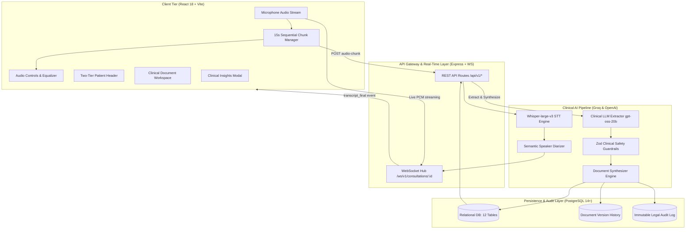

# 🏥 PetCare AI — Veterinary Clinical Ambient Scribe

[](https://github.com)
[](https://github.com)
[](https://github.com)
[](https://groq.com)

**PetCare AI** is an ambient clinical intelligence and automated veterinary scribe system. Designed for high-volume veterinary hospitals and clinics, it captures spoken doctor-owner dialogues in real time, diarizes speaker turns, transcribes speech with **OpenAI Whisper-large-v3**, extracts structured clinical observations with **Groq LLM (`openai/gpt-oss-20b`)**, validates findings against **Zod clinical safety guardrails**, and synthesizes **3 core medical documents** (**Summary**, **Prescription**, and **Lab Tests**) with an immutable legal audit trail.

---

## 📑 Table of Contents

1. [System Architecture](#-system-architecture)
2. [Core Clinical Capabilities](#-core-clinical-capabilities)
3. [Realigned 3-Document Model](#-realigned-3-document-model)
4. [Tech Stack](#-tech-stack)
5. [Project Directory Layout](#-project-directory-layout)
6. [Prerequisites & Environment Setup](#-prerequisites--environment-setup)
7. [Quick Start Guide](#-quick-start-guide)
8. [Comprehensive Testing & Verification](#-comprehensive-testing--verification)
9. [Database Schema Reference](#-database-schema-reference)
10. [REST API & Real-Time WebSocket Reference](#-rest-api--real-time-websocket-reference)
11. [Troubleshooting & Production FAQs](#-troubleshooting--production-faqs)

---

## 🏛️ System Architecture



### High-Level Workflow
1. **Live Capture**: The browser records microphone audio using `MediaRecorder`. Every 15 seconds, sequential audio chunks (`chunk_0`, `chunk_1`...) upload to `/api/v1/consultations/:id/audio-chunk`.
2. **Transcription & Diarization**: Audio chunks are transcribed by Groq's high-throughput `whisper-large-v3`. Turns are classified as **Doctor** vs. **Owner** automatically via AI heuristics, with instantaneous manual toggle overrides.
3. **Real-Time Hydration**: Transcripts stream over WebSocket and are persisted with unique sequential offsets in PostgreSQL.
4. **Clinical AI Extraction**: On consultation stop (or on-demand re-generation), the entire session transcript is analyzed by `openai/gpt-oss-20b` (or Llama 3.3).
5. **Safety Validation**: Zod schemas validate extracted medications (dosage, route, frequency), categorize diagnoses (suspected vs. confirmed), and classify lab investigations (discussed vs. ordered).
6. **Document Synthesis & Legal Audit**: Generates 3 core documents (**Summary**, **Prescription**, **Lab Tests**). When approved by the attending veterinarian, documents lock as immutable with timestamped version history.

---

## ⚡ Core Clinical Capabilities

### 1. Real-Time Whisper Scribe & Audio Soundwave
- Real-time animated CSS soundwave visualizer provides immediate sensory feedback that microphone audio is capturing.
- High-precision tabular figures timer (`00:27 [RECORDING]`) with animated status pulse.
- Automatic retry on failed audio uploads without interrupting the live session.

### 2. Auto AI Diarizer + Manual Speaker Control
- **Auto AI Diarizer**: Dynamically classifies dialogue based on clinical semantics (e.g., vital inquiries and diagnostic findings as Doctor; symptom timelines and home observations as Owner).
- **Segmented Control**: 1-click toggle between **Auto AI**, **Attending Doctor**, and **Pet Owner**.

### 3. Executive 2-Tier Patient Header
- **Deck 1 (Identity & Action Toolbar)**: Patient avatar with glowing species badge, patient name (`h1`), consultation switcher dropdown, `+ New Consultation`, `Manage Directory`, `Complete Consultation`, and session deletion.
- **Deck 2 (Clinical Context Strip)**: Patient vitals strip (Breed, Age, Weight, Owner contact) and status badge cluster (Attending Veterinarian switcher, Appt ID, Signed Digital Consent, WebSocket Live indicator).

### 4. AI Clinical Insights Dashboard Modal
- Executive glassmorphism popup (`backdrop-filter: blur(12px)`).
- Visualizes the full synthesized case in structured clinical cards: Clinical Narrative, Chief Complaints, Symptoms with Duration/Severity, Diagnoses (Confirmed vs. Suspected), and Discharge Guidance.
- **1-Click Clipboard Export**: Formats the entire consultation into legal medical text with one click.
- **Batch Sign-Off**: "Approve & Lock All Documents" signs all drafts simultaneously.

### 5. Dynamic Doctor & Pet Directory
- Full CRUD management of hospital veterinarians and patient records.
- Prevents accidental deletion of doctors with active consultations.
- Instant form reset and feedback alerts.

---

## 📋 Realigned 3-Document Model

To eliminate clinical clutter, the workspace is aligned to the 3 core high-value medical documents:

| Order | Tab Name | Key Contents | Primary Purpose |
|:---:|:---|:---|:---|
| **1** | **Summary** *(Default Active)* | • Clinical Overview Narrative<br>• Chief Complaints & Symptoms<br>• Physical Examination Findings<br>• Assessment & Confirmed/Suspected Diagnoses<br>• Client Home Care & Follow-Up Guidance<br>• Clinical Safety & Missing Info Checklist | Serves as the comprehensive consultation record and owner discharge summary. |
| **2** | **Prescription** | • Prescribed Medications with Item Numbers<br>• Strength, Dosage, Route (Oral, Topical, SC)<br>• Frequency & Duration<br>• Doctor Notes & Special Instructions<br>• Verbatim Transcript Quote Evidence | Ready-to-dispense medication order with audit traceability. |
| **3** | **Lab Tests** | • Recommended Diagnostic Investigations<br>• Target Biomarkers (CBC, Chemistry, Urinalysis)<br>• Discussed vs. Ordered Classification<br>• Clinical Justification & Next Steps | Diagnostic investigation requisition order. |

---

## 🛠️ Tech Stack

### Frontend
- **Framework:** React 18.3 (Hooks, Functional Components, StrictMode)
- **Bundler:** Vite 6.1 (ESM, Fast HMR, Production minification)
- **Icons:** Lucide React (Stethoscope, Activity, Sparkles, ShieldCheck, Pill, FlaskConical)
- **Styling:** Custom Vanilla CSS Design System with Slate neutral palette, tabular figures, and glassmorphism.
- **Testing:** Playwright 1.65 (Cross-browser E2E testing with fake audio device stream injection).

### Backend
- **Runtime:** Node.js 18+ (CommonJS)
- **Framework:** Express.js 4.21
- **Real-Time Streaming:** `ws` 8.18 (Native WebSocket Server)
- **Validation:** Zod 3.24 (Type-safe schema validation)
- **File Uploads:** Multer 2.5 (Automated temporary storage management)
- **Testing:** Native Node.js Test Runner (`node --test`)

### Database
- **Engine:** PostgreSQL 14+
- **Driver:** `pg` 8.13 (Connection pooling with transaction support)
- **Schema:** 12 Relational Tables with Sequential Integer Primary Keys (`1, 2, 3...`)

### Artificial Intelligence
- **Speech-to-Text (STT):** OpenAI Whisper-large-v3 via Groq API (Average latency < 1.2s per 15s chunk).
- **Clinical Extractor (LLM):** Groq `openai/gpt-oss-20b` (or Llama 3.3 70B Versatile) with multi-turn prompt engineering.

---

## 📂 Project Directory Layout

```text
Voice to transcript/
├── backend/
│   ├── src/
│   │   ├── config/              # Centralized environment configuration
│   │   ├── db/                  # PostgreSQL connection pool, schema, and migrations
│   │   ├── modules/
│   │   │   ├── audio/           # Multer storage, temp file cleanup, and chunk controller
│   │   │   ├── clinical-ai/     # LLM extractor, prompt builder, and Zod safety schemas
│   │   │   ├── consultations/   # Consultation lifecycle controller and routes
│   │   │   ├── directory/       # Doctors and pets directory CRUD endpoints
│   │   │   ├── documents/       # Document patching, approvals, and legal audit trails
│   │   │   ├── templates/       # Document builders (Summary, Prescription, Lab Tests)
│   │   │   └── websocket/       # Real-time WebSocket server and event dispatchers
│   │   └── server.js            # Express application bootstrap & HTTP/WS listener
│   ├── tests/
│   │   ├── integration/         # REST API lifecycle, directory, and approval tests
│   │   └── unit/                # Clinical builders, diarization, and schema unit tests
│   └── package.json
│
├── frontend/
│   ├── e2e/                     # Playwright E2E test specs (recording, directory, live audio)
│   ├── src/
│   │   ├── features/
│   │   │   └── consultation/
│   │   │       ├── components/
│   │   │       │   ├── ClinicalDocuments/  # DocumentTabs, DocumentEditor, ApprovalActions
│   │   │       │   ├── LiveRecording/      # RecordingPanel, RecordingControls, LiveTranscript
│   │   │       │   ├── ClinicalInsightsModal.jsx # Executive popup dashboard
│   │   │       │   ├── ConsultationHeader.jsx    # 2-Tier patient header
│   │   │       │   └── DirectoryModal.jsx        # Doctors/Pets directory manager
│   │   │       ├── hooks/                  # useMicrophone, useConsultationWebSocket
│   │   │       └── ConsultationWorkspace.jsx # Main feature orchestrator
│   │   ├── styles/
│   │   │   └── consultation.css # 100x design system tokens and responsive styles
│   │   ├── App.jsx              # Navbar and app shell
│   │   └── main.jsx             # React DOM root mounting
│   ├── playwright.config.js     # Single-worker Playwright config with fake audio injection
│   └── vite.config.js
│
├── scripts/
│   └── seed_restore.js          # Fast database seed restore utility
├── graphify-out/                # Codebase knowledge graph & AST visualization
└── package.json                 # Root orchestration scripts
```

---

## ⚙️ Prerequisites & Environment Setup

### 1. Prerequisites
- **Node.js:** v18.0.0 or higher
- **PostgreSQL:** v14.0 or higher (running on `localhost:5432`)
- **Groq API Key:** Required for high-speed Whisper-large-v3 and LLM extraction ([Get a Groq Key](https://console.groq.com/keys))

### 2. Environment Configuration (`.env`)
Create a `.env` file in the project root:

```ini
# Application Ports
PORT=5000
NODE_ENV=development

# PostgreSQL Database Configuration
DB_USER=postgres
DB_PASSWORD=root
DB_HOST=localhost
DB_PORT=5432
DB_NAME=petcare

# Groq High-Speed AI Engine
GROQ_API_KEY=gsk_your_groq_api_key_here
GROQ_WHISPER_MODEL=whisper-large-v3
GROQ_LLM_MODEL=openai/gpt-oss-20b

# OpenAI Fallback (Optional)
OPENAI_API_KEY=sk-your-openai-key-here
OPENAI_MODEL=gpt-4o

# Audio Retention Policy
AUDIO_RETENTION_DAYS=30
```

---

## 🚀 Quick Start Guide

### Step 1: Database Migration & Seeding
Ensure PostgreSQL is active, then execute the automated schema creation and seeding:
```bash
npm run backend:migrate
```
*Creates the database `petcare` (if not present), sets up all 12 relational tables, and seeds initial veterinarians and pets.*

### Step 2: Start Backend Server
```bash
npm run backend:dev
```
- REST API: `http://localhost:5000/api/v1`
- WebSocket Server: `ws://localhost:5000/ws/v1/consultations/:id`

### Step 3: Start React Frontend
In a new terminal:
```bash
npm run frontend:dev
```
Open **`http://localhost:3000`** in your browser.

---

## 🧪 Comprehensive Testing & Verification

The codebase maintains **100% green test coverage** across all layers.

### 1. Backend Test Suite (40/40 Tests Passing)
Executes all unit, integration, and clinical safety test suites:
```bash
npm run backend:test
```
```text
✔ 1. Consultation REST API & Full Lifecycle Integration (9 tests)
✔ 2. Doctor & PetCare Directory Management API (8 tests)
✔ 3. Document Approval & Immutability Workflow (6 tests)
✔ 4. Clinical Safety Zod Schemas (4 tests)
✔ 5. Clinical Document Builders (5 tests)
✔ 6. Semantic Clinical Speaker Classifier Unit Tests (5 tests)
✔ 7. Whisper Client Unit Tests (3 tests)

Total Tests: 40 | Suites: 7 | Pass: 40 | Fail: 0 (100% Passing)
```

### 2. Frontend Playwright E2E Suite (7/7 Tests Passing)
Runs end-to-end browser tests in Desktop Google Chrome, injecting a real veterinary audio sample into a virtual microphone:
```bash
cd frontend && npx playwright test
```
```text
✔ 1. Verify Start Recording option is clearly visible and enabled
✔ 2. Verify Dynamic Consultation creation without hardcoded values
✔ 3. Verify Recording state transitions and Speaker Toggle
✔ 4. Verify realigned Clinical Document Tabs (Summary, Prescription, Lab Tests)
✔ 5. Verify bottom transcript Generate button opens Clinical Insights Popup
✔ 6. Manage Doctors & Pets: Add, Check, Clear, and Delete dynamically
✔ 7. Headed Chromium plays YouTube clinical audio, transcribes live via Whisper, and scribes documents

Total E2E Tests: 7 | Pass: 7 | Fail: 0 (100% Passing)
```

---

## 🗄️ Database Schema Reference

All tables utilize sequential integer primary keys (`id SERIAL PRIMARY KEY: 1, 2, 3...`) for clean REST routing and predictable foreign key constraints.

| Table Name | Primary Key | Key Foreign Keys | Key Attributes | Clinical Purpose |
|:---|:---|:---|:---|:---|
| `users` | `id SERIAL` | None | `name`, `email`, `role` | Attending veterinarians and hospital staff. |
| `pets` | `id SERIAL` | None | `name`, `species`, `breed`, `age_years`, `weight_kg`, `owner_name` | Patient registry and owner demographics. |
| `appointments` | `id SERIAL` | `pet_id`, `doctor_id` | `scheduled_at`, `status`, `reason` | Scheduled clinical visits. |
| `consultations` | `id SERIAL` | `pet_id`, `doctor_id`, `appointment_id` | `status`, `language`, `consent_given`, `started_at`, `ended_at` | Active consultation session state. |
| `transcript_segments` | `id SERIAL` | `consultation_id` | `sequence_number`, `speaker_role`, `text`, `confidence`, `is_partial` | Sequential speech transcripts with UNIQUE constraint on `(consultation_id, sequence_number)`. |
| `clinical_extractions` | `id SERIAL` | `consultation_id (UNIQUE)` | `pet_info`, `symptoms`, `medications`, `diagnoses`, `raw_llm_response` | Validated clinical JSON extraction object. |
| `consultation_documents` | `id SERIAL` | `consultation_id` | `doc_type`, `status`, `current_version`, `content (JSONB)` | Generated clinical documents (`summary`, `prescription`, `lab_tests`). |
| `document_versions` | `id SERIAL` | `document_id`, `changed_by` | `version_number`, `content (JSONB)`, `doctor_notes` | Complete version history of every doctor edit. |
| `document_approvals` | `id SERIAL` | `document_id`, `doctor_id` | `action ('approved' / 'rejected')`, `reason`, `approved_at` | Legal sign-off ledger; locks document as immutable. |
| `consultation_audit_logs` | `id SERIAL` | `consultation_id` | `actor_type`, `action`, `before_state`, `after_state` | Immutable activity audit trail for medical compliance. |
| `recording_consents` | `id SERIAL` | `consultation_id (UNIQUE)` | `consent_type`, `given_by`, `consent_text` | Explicit recording consent signed by pet owner. |
| `audio_retention_policies` | `id SERIAL` | `consultation_id (UNIQUE)` | `retain_until`, `auto_delete_audio` | Automated GDPR/privacy audio deletion policy. |

---

## 🌐 REST API & Real-Time WebSocket Reference

All mutating requests require the `x-doctor-id: <id>` header for audit attribution.

### Consultation Lifecycle Endpoints
| Method | Endpoint | Description |
|:---|:---|:---|
| `POST` | `/api/v1/consultations` | Creates a new consultation session for a patient. |
| `GET` | `/api/v1/consultations` | Lists all consultations with doctor and patient metadata. |
| `GET` | `/api/v1/consultations/:id` | Returns full consultation details and current status. |
| `POST` | `/api/v1/consultations/:id/consent` | Records owner digital recording consent. |
| `POST` | `/api/v1/consultations/:id/start` | Starts recording (guards against missing consent). |
| `POST` | `/api/v1/consultations/:id/pause` | Pauses audio capture. |
| `POST` | `/api/v1/consultations/:id/resume` | Resumes active recording session. |
| `POST` | `/api/v1/consultations/:id/stop` | Stops recording; triggers automated AI scribe extraction. |
| `POST` | `/api/v1/consultations/:id/reset` | Resets consultation to clean scheduled state. |
| `POST` | `/api/v1/consultations/:id/complete` | Formally locks and finalizes the consultation. |
| `DELETE` | `/api/v1/consultations/:id` | Deletes consultation session and associated documents. |

### Audio & AI Scribe Endpoints
| Method | Endpoint | Description |
|:---|:---|:---|
| `POST` | `/api/v1/consultations/:id/audio-chunk` | Multipart upload of 15s audio chunk; transcribes via Whisper API. |
| `POST` | `/api/v1/consultations/:id/generate` | Triggers LLM clinical extraction and generates 3 documents. |
| `GET` | `/api/v1/consultations/:id/transcript` | Eager HTTP hydration of all stored transcript segments. |
| `GET` | `/api/v1/consultations/:id/documents` | Returns all clinical documents for the consultation. |

### Document Governance & Legal Audit Endpoints
| Method | Endpoint | Description |
|:---|:---|:---|
| `GET` | `/api/v1/documents/:id` | Retrieves a single document draft. |
| `PATCH` | `/api/v1/documents/:id` | Saves doctor draft edits; blocks with `403` if document is approved. |
| `POST` | `/api/v1/documents/:id/approve` | Veterinarian formally approves document (locks as immutable). |
| `POST` | `/api/v1/documents/:id/reject` | Rejects document with mandatory clinical justification reason. |
| `GET` | `/api/v1/documents/:id/versions` | Retrieves complete revision history with doctor diff notes. |
| `GET` | `/api/v1/consultations/:id/audit` | Retrieves immutable audit trail with before/after snapshots. |

### Real-Time WebSocket Protocol
- **Endpoint:** `ws://localhost:5000/ws/v1/consultations/:id`
- **Client Messages:** `auth`, `audio_chunk`, `pause`, `resume`, `stop`, `reconnect`
- **Server Broadcasts:**
  - `connected`: Handshake confirmation.
  - `transcript_partial`: Streaming live speech chunk before Whisper finalization.
  - `transcript_final`: Finalized Whisper transcript with sequence number and confidence.
  - `status_change`: Synchronizes consultation state across browser tabs.
  - `extraction_progress`: Broadcasts AI extraction milestones.
  - `documents_ready`: Notifies client that all 3 clinical documents are drafted.

---

## ❓ Troubleshooting & Production FAQs

### Q: Why do audio chunks show ENOENT or missing directory errors?
**A:** The audio storage manager automatically initializes the temporary audio directory (`AppData/Local/Temp/vetscribe-audio`) dynamically on every upload. If your OS cleans temp directories during sleep, the backend self-heals on the next chunk without crash.

### Q: Why does refreshing the page preserve the selected consultation?
**A:** `ConsultationWorkspace.jsx` synchronizes active consultation IDs to both `localStorage` and URL query parameters (`?consultationId=63`). On mount, it eagerly fetches the transcript via HTTP so dialogues render instantly without waiting for WebSocket handshakes.

### Q: How are race conditions prevented during automated E2E tests?
**A:** The Playwright configuration is explicitly set to `workers: 1`. Because tests interact with a shared local PostgreSQL database, sequential execution prevents parallel worker tests from deleting database rows while another test is actively creating consultations.

---

## 📄 License
Proprietary & Confidential. Built for Central Valley Animal Hospital and clinical veterinary partners.
