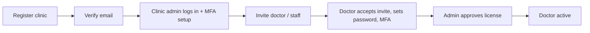

# Phase 1 — Identity, RBAC & Multi-Tenancy

> **Goal:** Nobody can access anything without an authenticated identity, and no clinic can see another clinic's data.  
> **Estimated Duration:** 3–4 weeks (2–3 developers)  
> **Primary Outcome:** Secure login, clinics isolation, granular roles, zero header-spoofing vulnerability.

---

## 1. Guiding Principles & Golden Rules for Phase 1

1. **Every query is tenant-scoped.** No exceptions. All queries must enforce `clinic_id`.
2. **Identity comes from the JWT, never from request headers.** Remove all `x-doctor-id` trust.
3. **Every sensitive action writes to the audit ledger.**
4. **Row-Level Security (RLS)** in PostgreSQL guarantees separation at the database layer, not just application code.
5. **Phase exit requires passing security tests** (cross-tenant access suite, role matrix, token reuse detection).

---

## 2. Database Migrations

```sql
-- 1. Tenancy Core
CREATE TABLE clinics (
    id SERIAL PRIMARY KEY,
    name VARCHAR(255) NOT NULL,
    slug VARCHAR(100) UNIQUE NOT NULL,
    status VARCHAR(50) DEFAULT 'active',
    plan_id INT,
    timezone VARCHAR(50) DEFAULT 'Asia/Kolkata',
    locale VARCHAR(10) DEFAULT 'en',
    created_at TIMESTAMPTZ DEFAULT NOW()
);

-- 2. Identity & Users (ALTER existing or CREATE)
-- users table: add clinic_id (nullable ONLY for super_admin)
ALTER TABLE users 
    ADD COLUMN clinic_id INT REFERENCES clinics(id),
    ADD COLUMN email_verified_at TIMESTAMPTZ,
    ADD COLUMN phone VARCHAR(20),
    ADD COLUMN phone_verified_at TIMESTAMPTZ,
    ADD COLUMN status VARCHAR(50) DEFAULT 'pending_verification', -- pending_verification | active | suspended
    ADD COLUMN license_number VARCHAR(100),
    ADD COLUMN license_verified_at TIMESTAMPTZ,
    ADD COLUMN signature_image_key VARCHAR(255),
    ADD COLUMN last_login_at TIMESTAMPTZ;

-- Credentials & Passwords
CREATE TABLE user_credentials (
    user_id INT PRIMARY KEY REFERENCES users(id) ON DELETE CASCADE,
    password_hash VARCHAR(255) NOT NULL,
    password_changed_at TIMESTAMPTZ DEFAULT NOW(),
    failed_attempts INT DEFAULT 0,
    locked_until TIMESTAMPTZ
);

-- Refresh Tokens (Rotation & Reuse Detection)
CREATE TABLE refresh_tokens (
    id UUID PRIMARY KEY DEFAULT gen_random_uuid(),
    user_id INT NOT NULL REFERENCES users(id) ON DELETE CASCADE,
    token_hash VARCHAR(255) NOT NULL,
    device_info VARCHAR(255),
    ip VARCHAR(45),
    expires_at TIMESTAMPTZ NOT NULL,
    revoked_at TIMESTAMPTZ,
    created_at TIMESTAMPTZ DEFAULT NOW()
);

-- Multi-Factor Authentication Secrets
CREATE TABLE mfa_secrets (
    user_id INT PRIMARY KEY REFERENCES users(id) ON DELETE CASCADE,
    secret_encrypted TEXT NOT NULL,
    enabled_at TIMESTAMPTZ DEFAULT NOW(),
    recovery_codes_hash TEXT[]
);

-- OTP Codes (Phone / Login / Verification)
CREATE TABLE otp_codes (
    id UUID PRIMARY KEY DEFAULT gen_random_uuid(),
    target VARCHAR(100) NOT NULL, -- phone or email
    purpose VARCHAR(50) NOT NULL, -- 'owner_login', 'phone_verify', 'password_reset'
    code_hash VARCHAR(255) NOT NULL,
    expires_at TIMESTAMPTZ NOT NULL,
    attempts INT DEFAULT 0,
    consumed_at TIMESTAMPTZ
);

-- Clinic Staff Invitations
CREATE TABLE invitations (
    id UUID PRIMARY KEY DEFAULT gen_random_uuid(),
    clinic_id INT NOT NULL REFERENCES clinics(id) ON DELETE CASCADE,
    email VARCHAR(255) NOT NULL,
    role VARCHAR(50) NOT NULL, -- 'doctor', 'staff', 'clinic_admin'
    token_hash VARCHAR(255) NOT NULL,
    invited_by INT REFERENCES users(id),
    expires_at TIMESTAMPTZ NOT NULL,
    accepted_at TIMESTAMPTZ
);

-- Password Resets
CREATE TABLE password_resets (
    id UUID PRIMARY KEY DEFAULT gen_random_uuid(),
    user_id INT NOT NULL REFERENCES users(id) ON DELETE CASCADE,
    token_hash VARCHAR(255) NOT NULL,
    expires_at TIMESTAMPTZ NOT NULL,
    used_at TIMESTAMPTZ
);
```

### Backfill & RLS Policy
```sql
-- Add clinic_id to ALL existing tenant tables:
-- pets, appointments, consultations, transcript_segments, consultation_audio,
-- consultation_audio_chunks, clinical_extractions, consultation_documents,
-- document_versions, document_approvals, consultation_audit_ledger,
-- recording_consents, audio_retention_policies

-- 1. Create default clinic for existing single-clinic data
INSERT INTO clinics (name, slug, timezone, locale) 
VALUES ('Central Valley Animal Hospital', 'central-valley', 'Asia/Kolkata', 'en');

-- 2. Backfill existing tables
UPDATE pets SET clinic_id = 1 WHERE clinic_id IS NULL;
UPDATE appointments SET clinic_id = 1 WHERE clinic_id IS NULL;
UPDATE consultations SET clinic_id = 1 WHERE clinic_id IS NULL;
UPDATE transcript_segments SET clinic_id = 1 WHERE clinic_id IS NULL;
UPDATE consultation_audio SET clinic_id = 1 WHERE clinic_id IS NULL;
UPDATE consultation_audio_chunks SET clinic_id = 1 WHERE clinic_id IS NULL;
UPDATE clinical_extractions SET clinic_id = 1 WHERE clinic_id IS NULL;
UPDATE consultation_documents SET clinic_id = 1 WHERE clinic_id IS NULL;
UPDATE document_versions SET clinic_id = 1 WHERE clinic_id IS NULL;
UPDATE document_approvals SET clinic_id = 1 WHERE clinic_id IS NULL;
UPDATE consultation_audit_ledger SET clinic_id = 1 WHERE clinic_id IS NULL;
UPDATE recording_consents SET clinic_id = 1 WHERE clinic_id IS NULL;
UPDATE audio_retention_policies SET clinic_id = 1 WHERE clinic_id IS NULL;

-- 3. Enforce NOT NULL & Add Composite Indexes
ALTER TABLE consultations ALTER COLUMN clinic_id SET NOT NULL;
CREATE INDEX idx_consultations_clinic_created ON consultations(clinic_id, created_at DESC);
-- (repeat NOT NULL and indexes for other tenant tables)

-- 4. Enable Row-Level Security (RLS)
ALTER TABLE consultations ENABLE ROW LEVEL SECURITY;
CREATE POLICY clinic_isolation_policy ON consultations
    FOR ALL
    USING (clinic_id = current_setting('app.clinic_id', true)::int);

-- 5. Audit ledger chain per clinic:
-- Hash chain scoped to (clinic_id) so tenants are mathematically independent.
```

---

## 3. Backend Modules Structure

```
backend/src/modules/
  auth/        # signup, login, logout, refresh, otp, reset, verify-email
  mfa/         # TOTP enroll/verify/recovery
  rbac/        # role + permission definitions, middleware
  tenancy/     # clinic context middleware, RLS session setter
  invitations/ # create/accept
  sessions/    # list/revoke devices
```

### Middleware Execution Chain

```
Request
  │
  ▼
rateLimit (Account + IP throttle)
  │
  ▼
authenticate (JWT in httpOnly cookie)
  │
  ▼
loadUser (Fetch status, clinic, roles)
  │
  ▼
tenantContext (Extract clinic_id → SET LOCAL app.clinic_id)
  │
  ▼
authorize(permission) (Verify role permissions)
  │
  ▼
Controller
```

### Endpoints Specification

| Method | Endpoint | Notes |
|:---|:---|:---|
| `POST` | `/auth/register-clinic` | Creates clinic + first `clinic_admin` (14-day trial) |
| `POST` | `/auth/login` | Email + password; returns MFA challenge if enabled |
| `POST` | `/auth/mfa/verify` | TOTP code completes login session |
| `POST` | `/auth/otp/request` · `/auth/otp/verify` | Phone OTP (owners) |
| `POST` | `/auth/refresh` | Rotating refresh token (reuse detection) |
| `POST` | `/auth/logout` · `/auth/logout-all` | Revoke current session or all active sessions |
| `POST` | `/auth/forgot-password` · `/auth/reset-password` | Expiring single-use token |
| `GET`  | `/auth/verify-email?token=` | Email verification flow |
| `POST` | `/invitations` | Clinic admin invites staff/doctor |
| `POST` | `/invitations/:token/accept` | Sets password, completes onboarding |
| `GET`  | `/me` · `/me/sessions` | Current user profile, active sessions |

---

## 4. Security Implementation Checklist

- [ ] **argon2id** password hashing with min length 10, breached-password check via HIBP k-anonymity API.
- [ ] **Token Lifespans:** Access token 15 min, refresh token 14 days.
- [ ] **Rotation & Reuse Detection:** Family invalidation if an old refresh token is reused.
- [ ] **Cookie Security:** `httpOnly`, `Secure`, `SameSite=Lax`. CSRF token validation on mutating endpoints.
- [ ] **Rate Limiting:** 5 failed login attempts / 15 min per account + IP; lockout with exponential backoff.
- [ ] **Mandatory MFA:** Required for `doctor`, `clinic_admin`, and `super_admin`.
- [ ] **OTP Security:** 6 digits, 5 min expiry, maximum 5 attempts, 60-second resend cooldown.
- [ ] **Network & Headers:** Helmet headers enabled, strict CORS allowlist, request size limitations.
- [ ] **Encryption:** Secrets managed via environment/vault; PII columns encrypted with `pgcrypto` or application-level AES-256-GCM.
- [ ] **Doctor Verification:** Doctor accounts start in `pending_verification` state until clinic admin approves license.

---

## 5. Remove Header Trust (Critical Migration)

Eliminate all reliance on `x-doctor-id` across controllers, services, and web sockets.

```javascript
// BEFORE (VULNERABLE)
const doctorId = req.headers['x-doctor-id'];

// AFTER (SECURE)
const doctorId = req.user.id;        // from verified JWT
const clinicId = req.user.clinicId;  // from tenantContext middleware
```

*Audit ledger events must now capture:* `actor_user_id`, `actor_role`, `ip`, and `user_agent`.

---

## 6. Frontend Architecture

```
frontend/src/
  auth/
    LoginPage.jsx
    SignupClinicPage.jsx
    AcceptInvitePage.jsx
    ForgotPasswordPage.jsx
    MfaSetupPage.jsx
    OtpLoginPage.jsx
  routes/
    ProtectedRoute.jsx
    RoleRoute.jsx
    RoleRedirect.jsx
  shell/
    RoleAwareLayout.jsx
    Navbar.jsx
    ProfileMenu.jsx
  api/
    client.js      # Fetch/Axios wrapper: credentials: 'include', silent 401 refresh
```

- **Role-based post-login redirects:**
  - `doctor` → `/doctor`
  - `pet_owner` → `/owner`
  - `clinic_admin` → `/admin`
  - `staff` → `/desk`
  - `super_admin` → `/superadmin`
- Existing consultation workspace transitions under `/doctor/consultations/:id`.

---

## 7. Test Suite (Must Pass Before Phase Exit)

1. **Cross-Tenant Access Suite:** User of Clinic A requests endpoints with Clinic B IDs; every request must yield `403 Forbidden` or `404 Not Found`.
2. **RBAC Matrix Suite:** Test each role against every endpoint to assert permission boundaries.
3. **Token Integrity Suite:** Test refresh-token reuse detection, account lockout, OTP brute force, and expired invitations.
4. **WebSocket Authentication:** Reject unauthenticated connections; assert user can only subscribe to their own clinic's consultation events.

---

## 8. Exit Criteria

- [ ] `x-doctor-id` completely removed from all backend and frontend code.
- [ ] Row-Level Security (RLS) active and verified on all tenant tables.
- [ ] Complete flow functional: Register clinic → Verify email → Login → Setup MFA → Invite staff → Doctor accepts & verifies license.
- [ ] Consultation audio recording, transcription, and drafting pipeline operates seamlessly for authenticated doctors.



