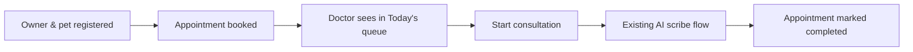

# Phase 2 — Clinic Admin, Registry & Scheduling

> **Goal:** A clinic can manage staff, pets, owners, and appointments without developer intervention.  
> **Estimated Duration:** 3 weeks (2–3 developers)  
> **Primary Outcome:** Fully autonomous clinic operations for registries, scheduling, doctor availability, and audit logging.

---

## 1. Guiding Principles for Phase 2

1. **Registry Single Source of Truth:** Owners and pets are tenant-scoped registries that link directly to appointments and clinical records.
2. **Clinical Safety in UI:** Allergies and chronic conditions entered in the registry must automatically surface in the doctor's consultation view.
3. **Double-Booking Prevention:** Scheduling engine strictly enforces availability windows, slot duration, and buffers.
4. **Timezone Awareness:** All appointment timestamps stored in UTC; rendered in the clinic's local timezone.
5. **Audited Changes:** Staff modifications, role changes, and exports record directly to `audit_events`.

---

## 2. Database Schema

```sql
-- 1. Owners Registry
CREATE TABLE owners (
    id SERIAL PRIMARY KEY,
    clinic_id INT NOT NULL REFERENCES clinics(id) ON DELETE CASCADE,
    name VARCHAR(255) NOT NULL,
    phone VARCHAR(20) NOT NULL,
    email VARCHAR(255),
    address TEXT,
    preferred_language VARCHAR(10) DEFAULT 'en', -- en, hi, ta
    user_id INT REFERENCES users(id) ON DELETE SET NULL, -- linked when owner registers portal account
    created_at TIMESTAMPTZ DEFAULT NOW()
);
CREATE INDEX idx_owners_clinic_phone ON owners(clinic_id, phone);

-- 2. Pet-Owner Many-to-Many Relationship
CREATE TABLE pet_owners (
    pet_id INT NOT NULL REFERENCES pets(id) ON DELETE CASCADE,
    owner_id INT NOT NULL REFERENCES owners(id) ON DELETE CASCADE,
    is_primary BOOLEAN DEFAULT TRUE,
    created_at TIMESTAMPTZ DEFAULT NOW(),
    PRIMARY KEY (pet_id, owner_id)
);

-- 3. Pets Table Extensions
ALTER TABLE pets
    ADD COLUMN species VARCHAR(50) NOT NULL DEFAULT 'Canine', -- Canine, Feline, Avian, etc.
    ADD COLUMN breed VARCHAR(100),
    ADD COLUMN sex VARCHAR(20), -- Male, Female, Neutered Male, Spayed Female
    ADD COLUMN dob DATE,
    ADD COLUMN microchip_no VARCHAR(100),
    ADD COLUMN allergies JSONB DEFAULT '[]'::jsonb,
    ADD COLUMN chronic_conditions JSONB DEFAULT '[]'::jsonb,
    ADD COLUMN photo_key VARCHAR(255);

-- 4. Clinic Settings & Letterhead
CREATE TABLE clinic_settings (
    clinic_id INT PRIMARY KEY REFERENCES clinics(id) ON DELETE CASCADE,
    letterhead_key VARCHAR(255),
    logo_key VARCHAR(255),
    address TEXT,
    phone VARCHAR(50),
    gstin VARCHAR(50),
    working_hours JSONB DEFAULT '{
        "monday": {"start": "09:00", "end": "19:00"},
        "tuesday": {"start": "09:00", "end": "19:00"},
        "wednesday": {"start": "09:00", "end": "19:00"},
        "thursday": {"start": "09:00", "end": "19:00"},
        "friday": {"start": "09:00", "end": "19:00"},
        "saturday": {"start": "09:00", "end": "17:00"},
        "sunday": null
    }'::jsonb,
    default_language VARCHAR(10) DEFAULT 'en',
    audio_retention_days INT DEFAULT 30
);

-- 5. Doctor Availability
CREATE TABLE doctor_availability (
    id SERIAL PRIMARY KEY,
    clinic_id INT NOT NULL REFERENCES clinics(id) ON DELETE CASCADE,
    doctor_id INT NOT NULL REFERENCES users(id) ON DELETE CASCADE,
    weekday INT NOT NULL CHECK (weekday BETWEEN 0 AND 6), -- 0=Sunday, 6=Saturday
    start_time TIME NOT NULL,
    end_time TIME NOT NULL,
    slot_minutes INT DEFAULT 15,
    is_active BOOLEAN DEFAULT TRUE
);
CREATE INDEX idx_doctor_avail ON doctor_availability(clinic_id, doctor_id, weekday);

-- 6. Appointments Table Extensions
ALTER TABLE appointments
    ADD COLUMN type VARCHAR(50) DEFAULT 'general_checkup', -- checkup, vaccination, emergency, surgery, follow_up
    ADD COLUMN duration_min INT DEFAULT 15,
    ADD COLUMN source VARCHAR(30) DEFAULT 'desk', -- 'owner' | 'desk' | 'doctor'
    ADD COLUMN cancelled_reason TEXT;

-- 7. General Operational Audit Log (Distinct from clinical hash chain)
CREATE TABLE audit_events (
    id UUID PRIMARY KEY DEFAULT gen_random_uuid(),
    clinic_id INT NOT NULL REFERENCES clinics(id) ON DELETE CASCADE,
    actor_user_id INT REFERENCES users(id),
    action VARCHAR(100) NOT NULL, -- 'staff_invited', 'role_changed', 'records_exported', 'settings_updated'
    target_type VARCHAR(50),
    target_id VARCHAR(100),
    metadata JSONB DEFAULT '{}'::jsonb,
    ip VARCHAR(45),
    user_agent TEXT,
    created_at TIMESTAMPTZ DEFAULT NOW()
);
CREATE INDEX idx_audit_events_clinic_time ON audit_events(clinic_id, created_at DESC);
```

---

## 3. Backend Modules & Endpoints

```
backend/src/modules/
  staff/           # Manage doctors and staff, approvals, deactivations
  owners/          # Owner registry, search, deduplication
  pets/            # Pet registry, medical profile, owner links
  scheduling/      # Doctor availability, appointment booking engine
  clinic-settings/ # Working hours, letterhead, branding
  audit-viewer/    # Audit query, tamper-check, CSV export
```

### Endpoints Specification

| Module | Method | Endpoint | Description |
|:---|:---|:---|:---|
| `staff` | `GET` | `/staff` | List clinic staff with roles and license status |
| `staff` | `PATCH` | `/staff/:id` | Update staff role or permissions |
| `staff` | `POST` | `/staff/:id/deactivate` | Deactivate staff member & revoke sessions |
| `staff` | `POST` | `/staff/:id/approve-license` | Clinic Admin verifies & approves doctor license |
| `owners` | `GET` | `/owners?query=` | Search owners by phone or name |
| `owners` | `POST` | `/owners` | Register new owner |
| `owners` | `POST` | `/owners/merge` | Merge duplicate owner records |
| `pets` | `GET` | `/pets?ownerId=` | Get pets by owner or clinic search |
| `pets` | `POST` | `/pets` | Register pet with allergies and conditions |
| `pets` | `PATCH` | `/pets/:id` | Update pet profile & medical flags |
| `scheduling` | `GET` | `/availability?doctorId=&date=` | Get available bookable slots |
| `scheduling` | `GET` | `/calendar?from=&to=&doctorId=` | Calendar overview for clinic appointments |
| `scheduling` | `POST` | `/appointments` | Create appointment (validates conflicts) |
| `scheduling` | `PATCH` | `/appointments/:id` | Reschedule or cancel appointment |
| `clinic-settings` | `GET` · `PATCH` | `/clinic-settings` | Read or update hours, logo, retention policy |
| `audit-viewer` | `GET` | `/audit?from=&to=&action=` | View filtered audit log |
| `audit-viewer` | `GET` | `/audit/verify-chain` | Run hash verification algorithm on audit ledger |
| `audit-viewer` | `GET` | `/audit/export.csv` | Export tamper-evident audit report |

---

## 4. Scheduling Engine Logic

1. **Slot Calculation:** Compute slots from `doctor_availability` matching requested date's weekday.
2. **Conflict Checking:** Reject bookings if an appointment intersects with an existing active appointment for that doctor.
3. **Clinic Operating Hours:** Validate requested slots fall within `clinic_settings.working_hours`.
4. **Buffer Times:** Support configurable 5-minute buffer between slots to avoid consultation spillover.

---

## 5. Doctor Portal Upgrades

- **Today's Queue:**
  - View all appointments assigned for today sorted chronologically.
  - One-click **"Start Consultation"**:
    - Generates consultation record pre-linked to appointment and pet.
    - Pre-populates owner and pet demographics.
- **Patient Banner inside Consultation Workspace:**
  - Displays: Pet Name, Species, Breed, Age, Weight, Microchip.
  - **Prominent Alert Badges:** Highlighting known allergies and chronic conditions.
- **Patient History Timeline:**
  - Sidebar displaying past visit dates, primary diagnoses, prescribed medications, and recorded vitals.

---

## 6. Clinic Admin Portal Pages

- `Dashboard`: Daily appointment counts, active doctors, recent activity.
- `Staff Management`: Invite staff, approve licenses, toggle active/inactive status.
- `Owners & Pets`: Registry search, owner profiles, pet profiles, duplicate merge tool.
- `Calendar View`: Multi-doctor day/week view with drag-and-drop rescheduling.
- `Settings`: Upload letterhead & logo, configure working hours, set audio retention limit.
- `Audit Log`: Real-time audit stream with an interactive **"Verify Integrity"** ledger validator.

---

## 7. Exit Criteria

- [ ] Clinic admin invites doctor, doctor accepts, admin approves license, doctor appears in scheduling.
- [ ] Appointment booking prevents double-booking and validates doctor availability.
- [ ] Clicking "Start Consultation" from queue opens consultation with pet pre-selected.
- [ ] Patient allergies and chronic conditions clearly appear in the consultation banner.
- [ ] Audit "Verify Integrity" endpoint returns valid / tampered hash results for the clinic's ledger.



