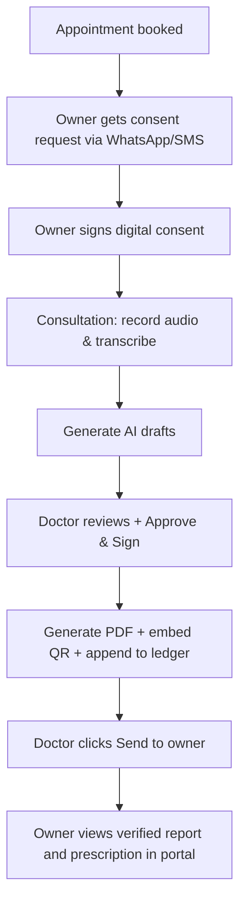

# Phase 3 — Owner Portal v1, Documents & Notifications

> **Goal:** Close the loop — pet owners consent digitally and receive tamper-evident signed reports and prescriptions.  
> **Estimated Duration:** 4 weeks (2–3 developers)  
> **Primary Outcome:** Self-service pet owner portal, automated PDF rendering pipeline with cryptographic QR verification, and multi-channel messaging (WhatsApp/SMS/Email).

---

## 1. Guiding Principles for Phase 3

1. **Digital Consent Enforcement:** Consultations cannot record audio without a valid digital owner consent or a logged doctor in-person attestation.
2. **Cryptographic Integrity:** Every generated PDF document is hashed (SHA-256) and anchored to the clinic's audit ledger.
3. **Zero PHI Exposure on Verification:** Public QR verification proves authenticity without exposing sensitive clinical details to unauthenticated scanners.
4. **Phone-First Identity:** Pet owners log in primarily through phone OTP; matching phone/email connects them automatically to existing clinic patient profiles.

---

## 2. Database Schema

```sql
-- 1. Versioned Consent Templates
CREATE TABLE consent_templates (
    id SERIAL PRIMARY KEY,
    clinic_id INT NOT NULL REFERENCES clinics(id) ON DELETE CASCADE,
    version INT NOT NULL DEFAULT 1,
    type VARCHAR(50) NOT NULL DEFAULT 'audio_recording', -- audio_recording, surgical, general_treatment
    title VARCHAR(255) NOT NULL,
    body_md TEXT NOT NULL,
    language VARCHAR(10) DEFAULT 'en',
    active BOOLEAN DEFAULT TRUE,
    created_at TIMESTAMPTZ DEFAULT NOW(),
    UNIQUE(clinic_id, type, version, language)
);

-- 2. Recording Consents Modifications
ALTER TABLE recording_consents
    ADD COLUMN template_id INT REFERENCES consent_templates(id),
    ADD COLUMN template_version INT,
    ADD COLUMN signed_by_owner_id INT REFERENCES owners(id),
    ADD COLUMN signature_image_key VARCHAR(255),
    ADD COLUMN ip VARCHAR(45),
    ADD COLUMN user_agent TEXT,
    ADD COLUMN signed_at TIMESTAMPTZ,
    ADD COLUMN revoked_at TIMESTAMPTZ;

-- 3. Generated Files & Cryptographic Fingerprints
CREATE TABLE generated_files (
    id UUID PRIMARY KEY DEFAULT gen_random_uuid(),
    clinic_id INT NOT NULL REFERENCES clinics(id) ON DELETE CASCADE,
    consultation_id INT NOT NULL REFERENCES consultations(id) ON DELETE CASCADE,
    doc_id INT REFERENCES consultation_documents(id) ON DELETE SET NULL,
    type VARCHAR(50) NOT NULL, -- 'prescription_pdf', 'visit_summary_pdf', 'invoice_pdf'
    storage_key VARCHAR(255) NOT NULL,
    sha256 VARCHAR(64) NOT NULL,
    ledger_hash VARCHAR(64) NOT NULL,
    created_at TIMESTAMPTZ DEFAULT NOW()
);
CREATE INDEX idx_gen_files_hash ON generated_files(ledger_hash);

-- 4. Notification Queue & Logs
CREATE TABLE notifications (
    id UUID PRIMARY KEY DEFAULT gen_random_uuid(),
    clinic_id INT NOT NULL REFERENCES clinics(id) ON DELETE CASCADE,
    owner_id INT REFERENCES owners(id) ON DELETE CASCADE,
    user_id INT REFERENCES users(id) ON DELETE SET NULL,
    channel VARCHAR(30) NOT NULL, -- 'whatsapp', 'sms', 'email', 'push'
    template VARCHAR(100) NOT NULL,
    payload JSONB NOT NULL DEFAULT '{}'::jsonb,
    status VARCHAR(30) DEFAULT 'pending', -- pending, sent, delivered, failed
    provider_id VARCHAR(100),
    scheduled_at TIMESTAMPTZ DEFAULT NOW(),
    sent_at TIMESTAMPTZ,
    error TEXT,
    created_at TIMESTAMPTZ DEFAULT NOW()
);
CREATE INDEX idx_notifications_status ON notifications(status, scheduled_at);

-- 5. Notification Preferences
CREATE TABLE notification_preferences (
    owner_id INT PRIMARY KEY REFERENCES owners(id) ON DELETE CASCADE,
    whatsapp_enabled BOOLEAN DEFAULT TRUE,
    sms_enabled BOOLEAN DEFAULT TRUE,
    email_enabled BOOLEAN DEFAULT TRUE,
    quiet_hours_start TIME,
    quiet_hours_end TIME
);

-- 6. Expiring Secure Share Links
CREATE TABLE share_links (
    id UUID PRIMARY KEY DEFAULT gen_random_uuid(),
    doc_id INT NOT NULL REFERENCES consultation_documents(id) ON DELETE CASCADE,
    token_hash VARCHAR(255) NOT NULL,
    expires_at TIMESTAMPTZ NOT NULL,
    accessed_count INT DEFAULT 0,
    created_at TIMESTAMPTZ DEFAULT NOW()
);
CREATE INDEX idx_share_links_token ON share_links(token_hash);
```

---

## 3. Owner Portal v1 Features

| View | Purpose | Key Capabilities |
|:---|:---|:---|
| **OTP Auth** | Login & Sign up | Phone OTP authentication; automatically links to existing `owners` record upon phone match. |
| **My Pets** | Pet Roster | View registered pets, vital history, and vaccination status. Add new pet profiles. |
| **Digital Consent** | Pre-Visit Consent | Review plain-language recording consent; sign via typed name or finger-drawn canvas. |
| **Visit Summaries** | Patient Records | Plain-language AI visit summaries, doctor recommendations, and home-care directives. |
| **Prescriptions** | Medications | View active medication list, dosage, and download signed official PDF. |
| **Booking** | Appointments | Book clinic slots, view upcoming appointments, reschedule, or cancel. |
| **Preferences** | Settings | Manage WhatsApp, SMS, and Email notification alerts. |

### Consent Enforcement Rule
The consultation `start` action requires either:
1. An owner-signed consent record (`recording_consents.signed_by_owner_id IS NOT NULL`), OR
2. A doctor-attested in-person consent toggle (explicitly recorded as a distinct event in the consultation audit ledger).

---

## 4. Signed PDF Generation Pipeline

```
Doctor clicks "Approve & Sign"
            │
            ▼
Enqueue BullMQ Job: `generate-pdf`
            │
            ▼
Playwright / Puppeteer Headless Renderer
  ├─ Clinic Header (Letterhead, Logo, Address, GSTIN)
  ├─ Patient & Owner Demographics Box
  ├─ Formatted Document Body (Prescription Rx / Summary)
  ├─ Doctor Details (Name, Registration/License No., Signature)
  └─ Render Cryptographic Verification QR Code
            │
            ▼
Compute SHA-256 of generated PDF
            │
            ▼
Upload to Object Storage (S3 / MinIO)
            │
            ▼
Record in `generated_files` & Append `document_pdf_issued` to Audit Ledger
```

### Public Verification Portal (`/verify/:ledgerHash`)
- Available publicly without login.
- Matches scanned QR code to the ledger block hash.
- Displays:
  - Document Status: `✓ Genuine & Verified` or `✗ Tampered / Not Found`
  - Issuing Clinic Name
  - Attending Doctor Name & Registration Number
  - Signed Timestamp
  - Pet Name & Visit Date
  - *No sensitive clinical notes or diagnosis exposed to public scanners.*

---

## 5. Notification Service Architecture

- **Provider Abstraction Interface:**
  ```javascript
  await notificationService.send({
    channel: 'whatsapp', // 'whatsapp' | 'sms' | 'email'
    to: owner.phone,
    template: 'documents_ready_notice',
    vars: { petName: pet.name, clinicName: clinic.name, link: docUrl },
    lang: owner.preferred_language || 'en'
  });
  ```
- **Supported Channels:**
  - WhatsApp: Meta Cloud API / Gupshup
  - SMS: MSG91 / Twilio
  - Email: AWS SES / Resend
- **Trigger Events:**
  - Appointment booked & confirmed
  - Automated appointment reminders (24 hours and 2 hours prior)
  - Pre-visit recording consent signature request
  - Doctor "Send to Owner" action: PDF ready notifications

---

## 6. Doctor "Send to Owner" Action

Inside the doctor's consultation workspace, once documents are signed:
1. Doctor reviews final signed documents.
2. Doctor clicks **"Send to Owner"**.
3. System triggers immediate WhatsApp & SMS notification containing a secure, time-expiring direct access link and owner portal notification.
4. Action logged to the consultation audit ledger (`documents_dispatched_to_owner`).

---

## 7. Exit Criteria

- [ ] Pet owner receives SMS/WhatsApp with pre-visit consent link, signs digitally on mobile device.
- [ ] Doctor consultation confirms consent status before allowing recording start.
- [ ] "Approve & Sign" triggers headless PDF generator; produces letterheaded PDF with doctor's signature.
- [ ] Scanning QR code on downloaded PDF opens `/verify/:ledgerHash` confirming tamper-evident validity.
- [ ] Security test confirms owner cannot view pets or documents belonging to another owner.



