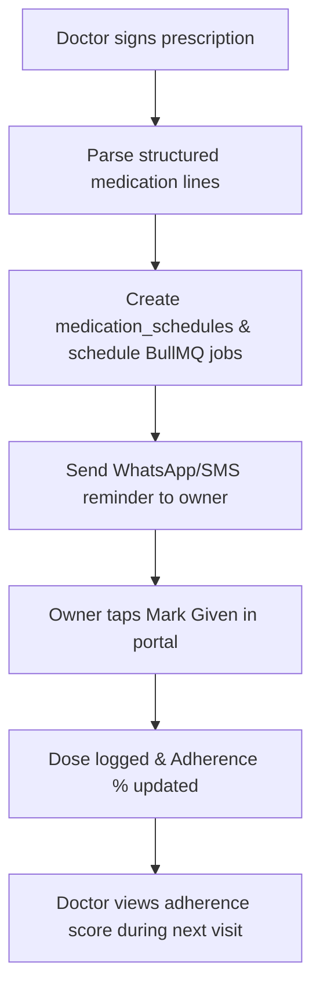

# Phase 4 — Retention Engine

> **Goal:** Increase pet owner retention, optimize medical adherence, and improve clinical outcomes through longitudinal patient intelligence.  
> **Estimated Duration:** 4 weeks (2–3 developers)  
> **Primary Outcome:** Automated medication adherence reminders, species-specific vaccination tracking, longitudinal AI patient memory, formulary dose safety validation, and multilingual discharge instructions.

---

## 1. Guiding Principles for Phase 4

1. **Active Care Continuity:** Care does not end when the patient leaves the clinic; active adherence reminders keep owners compliant.
2. **Preventive Health Automation:** Vaccines and wellness check-ups are automatically scheduled based on age, species, and breed protocols.
3. **Longitudinal AI Memory:** Consultations incorporate past visits, weight curves, and existing therapies into LLM prompts within strict token limits.
4. **Formulary Safety Checks:** Calculations against body weight (mg/kg), species contraindications, and breed sensitivities (e.g. MDR1) are validated at prescription generation.
5. **Multilingual Inclusivity:** Clinical notes remain in standard English, while owner discharge instructions are translated into local languages (Hindi, Tamil, etc.).

---

## 2. Database Schema

```sql
-- 1. Structured Medication Schedules
CREATE TABLE medication_schedules (
    id SERIAL PRIMARY KEY,
    clinic_id INT NOT NULL REFERENCES clinics(id) ON DELETE CASCADE,
    pet_id INT NOT NULL REFERENCES pets(id) ON DELETE CASCADE,
    prescription_doc_id INT REFERENCES consultation_documents(id) ON DELETE SET NULL,
    drug VARCHAR(255) NOT NULL,
    dose VARCHAR(100) NOT NULL,
    route VARCHAR(50) NOT NULL, -- oral, topical, subcutaneous, ophthalmic
    times JSONB NOT NULL,       -- e.g. ["08:00", "20:00"]
    start_date DATE NOT NULL,
    end_date DATE NOT NULL,
    instructions TEXT,
    is_active BOOLEAN DEFAULT TRUE,
    created_at TIMESTAMPTZ DEFAULT NOW()
);
CREATE INDEX idx_med_schedules_pet ON medication_schedules(pet_id, is_active);

-- 2. Dose Adherence Logs
CREATE TABLE dose_logs (
    id SERIAL PRIMARY KEY,
    schedule_id INT NOT NULL REFERENCES medication_schedules(id) ON DELETE CASCADE,
    due_at TIMESTAMPTZ NOT NULL,
    given_at TIMESTAMPTZ,
    status VARCHAR(20) DEFAULT 'pending', -- pending, given, missed, skipped
    logged_by VARCHAR(50), -- 'owner_portal', 'clinic_staff'
    notes TEXT,
    created_at TIMESTAMPTZ DEFAULT NOW()
);
CREATE INDEX idx_dose_logs_due ON dose_logs(due_at, status);

-- 3. Vaccinations History
CREATE TABLE vaccinations (
    id SERIAL PRIMARY KEY,
    clinic_id INT NOT NULL REFERENCES clinics(id) ON DELETE CASCADE,
    pet_id INT NOT NULL REFERENCES pets(id) ON DELETE CASCADE,
    vaccine VARCHAR(255) NOT NULL,
    given_on DATE NOT NULL,
    due_on DATE NOT NULL,
    batch_no VARCHAR(100),
    administered_by INT REFERENCES users(id),
    created_at TIMESTAMPTZ DEFAULT NOW()
);
CREATE INDEX idx_vaccinations_due ON vaccinations(due_on, clinic_id);

-- 4. Standard Vaccination Protocols
CREATE TABLE vaccine_protocols (
    id SERIAL PRIMARY KEY,
    species VARCHAR(50) NOT NULL, -- Canine, Feline
    vaccine VARCHAR(255) NOT NULL,
    start_age_weeks INT NOT NULL,
    interval_days INT,
    booster_rules JSONB DEFAULT '{}'::jsonb
);

-- 5. Longitudinal Vitals Tracking
CREATE TABLE vitals (
    id SERIAL PRIMARY KEY,
    clinic_id INT NOT NULL REFERENCES clinics(id) ON DELETE CASCADE,
    pet_id INT NOT NULL REFERENCES pets(id) ON DELETE CASCADE,
    consultation_id INT REFERENCES consultations(id) ON DELETE SET NULL,
    weight_kg NUMERIC(5,2),
    temp_c NUMERIC(4,2),
    hr INT,
    rr INT,
    recorded_at TIMESTAMPTZ DEFAULT NOW()
);
CREATE INDEX idx_vitals_pet_date ON vitals(pet_id, recorded_at DESC);

-- 6. Follow-Up Engagements
CREATE TABLE followups (
    id SERIAL PRIMARY KEY,
    clinic_id INT NOT NULL REFERENCES clinics(id) ON DELETE CASCADE,
    consultation_id INT NOT NULL REFERENCES consultations(id) ON DELETE CASCADE,
    suggested_date DATE NOT NULL,
    reason TEXT NOT NULL,
    status VARCHAR(50) DEFAULT 'pending', -- pending, scheduled, completed, dismissed
    appointment_id INT REFERENCES appointments(id) ON DELETE SET NULL,
    created_at TIMESTAMPTZ DEFAULT NOW()
);

-- 7. Post-Visit Symptom Check-ins
CREATE TABLE symptom_checkins (
    id SERIAL PRIMARY KEY,
    pet_id INT NOT NULL REFERENCES pets(id) ON DELETE CASCADE,
    followup_id INT REFERENCES followups(id) ON DELETE CASCADE,
    responses JSONB NOT NULL,
    photos TEXT[],
    created_at TIMESTAMPTZ DEFAULT NOW()
);

-- 8. Multilingual Translations Cache
CREATE TABLE translations_cache (
    id SERIAL PRIMARY KEY,
    doc_id INT NOT NULL REFERENCES consultation_documents(id) ON DELETE CASCADE,
    language VARCHAR(10) NOT NULL, -- hi, ta, te, kn, mr, bn
    content JSONB NOT NULL,
    model VARCHAR(100) NOT NULL,
    created_at TIMESTAMPTZ DEFAULT NOW(),
    UNIQUE(doc_id, language)
);
```

---

## 3. Medication Adherence Loop

1. **Structured Parsing:** When the doctor signs the prescription document, structured medication entries are parsed and converted into `medication_schedules`.
2. **Interactive Schedule Adjustments:** Doctor has a pre-dispatch confirmation modal to verify times (e.g. morning/evening intervals).
3. **Automated Reminders:** BullMQ scheduled worker queues WhatsApp/Push notifications at the exact scheduled medication time.
4. **Owner Logging:** Pet owner taps **"Mark Given"** directly inside the WhatsApp template or Owner Portal web app.
5. **Escalation Rules:**
   - 1 hour past due without confirmation: Reminder alert.
   - 4 hours past due: Marked as `missed`.
   - Adherence `< 75%`: Flagged on doctor's dashboard for follow-up review.

---

## 4. Vaccination & Preventive Care Engine

- **Automated Protocol Engine:** Matches pet's `dob`, `species`, and vaccine history against `vaccine_protocols` to automatically compute upcoming immunization dates.
- **3-Stage Campaign:**
  - **30 Days Before Due:** Educational reminder & preventive advisory.
  - **7 Days Before Due:** Direct scheduling link.
  - **1 Day Before Due:** Final reminder.
- **Instant Booking:** Owner clicks "Book Vaccination" from WhatsApp/SMS; automatically pre-fills doctor slot with "Vaccination" appointment type.

---

## 5. Longitudinal Patient Memory (AI)

Enhance the Clinical AI Prompt Builder by injecting a condensed, structured **Patient Context Block**:

```text
==================== PATIENT MEMORY BLOCK ====================
Patient: Bruno (Canine, Golden Retriever, 4y 2m, Male Neutered)
Known Allergies: Cephalexin (severe pruritus), Chicken protein
Chronic Conditions: Atopic dermatitis, Hip dysplasia (Grade 1)
Weight History: 31.2kg (Oct 2025) -> 30.5kg (Jan 2026) -> 29.8kg (Current)
Active Medications: Apoquel 16mg OD (ending in 3 days)
Past Diagnoses:
  - 2026-01-15: Bilateral otitis externa (Malassezia) -> Treated with Posatex
  - 2025-10-10: Flea allergy dermatitis -> Bravecto administered
==============================================================
```

### Safety Engine Enhancements
- **Drug-Allergy Cross-Check:** Automatically flags any newly prescribed medication matching known allergies or class contraindications.
- **Drug-Drug Interaction:** Checks newly recommended therapies against active treatments in `medication_schedules`.
- **Token Budget Optimization:** Summarizes older visit histories (>6 months) into concise high-density bullet points to keep LLM context lightweight and fast.

---

## 6. Dose Calculator & Safety Formulary v2

- **Database-Driven Formulary:** Moves medication rules from static JSON to a managed SQL database.
- **Safety Flags:**
  - `Overdose / Underdose Warning`: Checks prescribed mg against species-specific `mg/kg` boundaries.
  - `Species Contraindications`: Rejects medications toxic to felines (e.g., Acetaminophen, Permethrin).
  - `Breed Sensitivity`: Evaluates breeds prone to the MDR1 gene mutation (Collies, Australian Shepherds) when prescribing Ivermectin, Milbemycin, etc.
- **Hard Stop Protocol:** Prescriptions violating hard-stop safety thresholds require doctor override input with explicit reason, appended to the audit ledger.

---

## 7. Multilingual Owner Instructions

- Clinical documentation, diagnoses, and medical records remain strictly in medical **English**.
- Owner Instructions, dietary modifications, and home-care protocols are generated into `owners.preferred_language` (e.g. Hindi, Tamil, Telugu):
  - Model generates clear, pet-friendly lay language.
  - Prominently displays: `"AI-Translated for Owner Clarity • Original Doctor Sign-off in English"`.
  - Doctor can preview and edit translation before dispatching.
  - Results cached in `translations_cache` to minimize duplicate LLM generation costs.

---

## 8. Exit Criteria

- [ ] Signing a prescription generates automated dose schedules and pushes reminder notifications.
- [ ] Pet owner logs dose from mobile portal; adherence calculation updates in real-time.
- [ ] Vaccination protocol computes accurate due dates for dogs and cats across varying ages.
- [ ] Clinical AI prompt builder successfully injects historical memory block and triggers an alert if an allergic drug is mentioned in the conversation.
- [ ] Owner instructions render accurately in Hindi and Tamil and pass human review.



