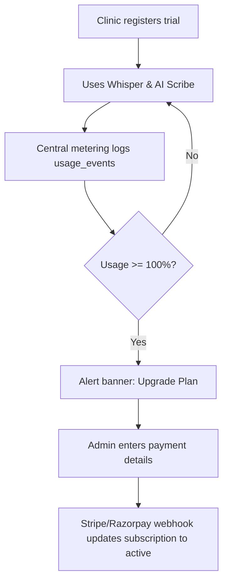

# Phase 5 — Business Layer

> **Goal:** Monetize the platform through SaaS subscription billing, meter AI & communications consumption, enable clinic-side invoicing, and deliver a comprehensive Super Admin operations portal.  
> **Estimated Duration:** 4 weeks (2–3 developers)  
> **Primary Outcome:** Full revenue cycle for clinics (consultation to invoice & payment links), multi-tenant SaaS metering with limit enforcement, and platform oversight tools for the Super Admin.

---

## 1. Guiding Principles for Phase 5

1. **Centralized Usage Instrumentation:** Every Whisper audio second, LLM token, SMS, and WhatsApp message must emit a `usage_events` record centrally.
2. **Predictable SaaS Margins:** Metering allows real-time calculation of gross margins per consultation and per clinic.
3. **Clinic Financial Autonomy:** Invoices are automatically drafted from consultation items (consultation fee + dispensed meds + lab orders) with GST compliance.
4. **Privacy-Preserving Super Admin:** Super Admin monitors system health, usage, and billing without default access to patient Protected Health Information (PHI).
5. **Audited Impersonation:** Any administrative user impersonation requires an explicit reason, generates a time-boxed token, shows a prominent persistent UI banner, and logs immediately to the clinic's audit ledger.

---

## 2. Database Schema

```sql
-- 1. Clinic Invoicing & Services Catalog
CREATE TABLE services (
    id SERIAL PRIMARY KEY,
    clinic_id INT NOT NULL REFERENCES clinics(id) ON DELETE CASCADE,
    name VARCHAR(255) NOT NULL,
    price NUMERIC(10,2) NOT NULL,
    tax_rate NUMERIC(5,2) DEFAULT 18.00, -- GST %
    category VARCHAR(50) DEFAULT 'consultation' -- consultation, lab, procedure, medication
);

CREATE TABLE invoices (
    id SERIAL PRIMARY KEY,
    clinic_id INT NOT NULL REFERENCES clinics(id) ON DELETE CASCADE,
    owner_id INT NOT NULL REFERENCES owners(id) ON DELETE CASCADE,
    pet_id INT REFERENCES pets(id) ON DELETE SET NULL,
    consultation_id INT REFERENCES consultations(id) ON DELETE SET NULL,
    number VARCHAR(100) NOT NULL, -- GST compliant serial (e.g. CVAH-2026-0001)
    status VARCHAR(30) DEFAULT 'draft', -- draft, issued, paid, cancelled, refunded
    subtotal NUMERIC(10,2) NOT NULL,
    tax NUMERIC(10,2) NOT NULL,
    total NUMERIC(10,2) NOT NULL,
    due_at TIMESTAMPTZ,
    created_at TIMESTAMPTZ DEFAULT NOW(),
    UNIQUE(clinic_id, number)
);

CREATE TABLE invoice_items (
    id SERIAL PRIMARY KEY,
    invoice_id INT NOT NULL REFERENCES invoices(id) ON DELETE CASCADE,
    description VARCHAR(255) NOT NULL,
    qty INT NOT NULL DEFAULT 1,
    unit_price NUMERIC(10,2) NOT NULL,
    tax_rate NUMERIC(5,2) DEFAULT 18.00,
    ref_type VARCHAR(50), -- 'consultation_fee', 'prescription_item', 'lab_order'
    ref_id INT
);

CREATE TABLE payments (
    id SERIAL PRIMARY KEY,
    invoice_id INT NOT NULL REFERENCES invoices(id) ON DELETE CASCADE,
    method VARCHAR(50) NOT NULL, -- 'razorpay', 'stripe', 'upi', 'cash', 'card_terminal'
    amount NUMERIC(10,2) NOT NULL,
    provider_ref VARCHAR(255),
    paid_at TIMESTAMPTZ DEFAULT NOW()
);

-- 2. SaaS Subscriptions & Tiered Plans
CREATE TABLE plans (
    id SERIAL PRIMARY KEY,
    name VARCHAR(100) NOT NULL, -- Starter, Professional, Hospital Multi-Branch
    price_monthly NUMERIC(10,2) NOT NULL,
    included_audio_minutes INT NOT NULL,
    included_llm_tokens INT NOT NULL,
    max_doctors INT NOT NULL,
    features JSONB NOT NULL DEFAULT '{}'::jsonb
);

CREATE TABLE subscriptions (
    id SERIAL PRIMARY KEY,
    clinic_id INT UNIQUE NOT NULL REFERENCES clinics(id) ON DELETE CASCADE,
    plan_id INT NOT NULL REFERENCES plans(id),
    status VARCHAR(50) DEFAULT 'trialing', -- trialing, active, past_due, canceled
    trial_ends_at TIMESTAMPTZ,
    current_period_end TIMESTAMPTZ,
    provider_sub_id VARCHAR(255),
    created_at TIMESTAMPTZ DEFAULT NOW()
);

-- 3. Telemetry & Cost Metering
CREATE TABLE usage_events (
    id UUID PRIMARY KEY DEFAULT gen_random_uuid(),
    clinic_id INT NOT NULL REFERENCES clinics(id) ON DELETE CASCADE,
    consultation_id INT REFERENCES consultations(id) ON DELETE SET NULL,
    type VARCHAR(50) NOT NULL, -- 'whisper_seconds', 'llm_in', 'llm_out', 'sms', 'wa', 'storage_mb'
    quantity NUMERIC(12,4) NOT NULL,
    unit_cost NUMERIC(10,6) NOT NULL,
    model VARCHAR(100),
    created_at TIMESTAMPTZ DEFAULT NOW()
);
CREATE INDEX idx_usage_events_clinic ON usage_events(clinic_id, created_at);

-- 4. Dynamic Feature Flags
CREATE TABLE feature_flags (
    id SERIAL PRIMARY KEY,
    key VARCHAR(100) NOT NULL,
    clinic_id INT REFERENCES clinics(id) ON DELETE CASCADE, -- NULL = global default
    enabled BOOLEAN NOT NULL DEFAULT FALSE,
    rollout_pct INT DEFAULT 0,
    created_at TIMESTAMPTZ DEFAULT NOW()
);
CREATE UNIQUE INDEX idx_feature_flags_key_clinic ON feature_flags(key, (COALESCE(clinic_id, -1)));
```

---

## 3. Clinic-Side Billing Operations

1. **Automated Draft Invoicing:**
   - When a doctor marks a consultation completed, an invoice is automatically drafted.
   - Line items pre-populated:
     - Consultation base fee (from clinic services)
     - Dispensed medications (quantities and prices)
     - Lab investigations ordered
2. **Front Desk Review:**
   - Reception staff reviews invoice, adds miscellaneous clinic charges (bandages, grooming, boarding) if applicable.
3. **Payment Links:**
   - Direct integration with payment gateways (Razorpay / Stripe).
   - Instant WhatsApp/SMS payment link dispatched to pet owner.
   - Upon payment confirmation via webhook, invoice automatically flips to `paid` status and receipt PDF generates.

---

## 4. SaaS Usage Metering & Quotas

```
Client Request (Audio Chunk / LLM Synthesis / WhatsApp Notice)
                      │
                      ▼
Central Metering Wrapper (Intercepts API call)
                      │
                      ├─ Check current monthly usage vs. Plan limit
                      │    ├─ At 80%: Emit soft warning banner to clinic admin
                      │    └─ At 100%: Enforce plan limit or trigger overage rate
                      │
                      ├─ Execute Provider API Call (Groq / Gemini / Meta / MSG91)
                      │
                      ▼
Insert `usage_events` record asynchronously (BullMQ batch worker)
```

- **Trial Engine:** New clinics automatically receive a 14-day full-feature trial with capped audio minutes (e.g. 150 minutes).
- **Graceful Failover & Notifications:** When quotas are reached, in-app banner alerts prompt clinic admin to upgrade plans without interrupting in-flight emergency consultations.

---

## 5. Super Admin Portal

```
Super Admin Dashboard (/superadmin)
  ├── Clinics Management: Search, provision, suspend, delete (soft), change plan tiers
  ├── Subscription Analytics: MRR, trial conversion rate, churn analysis, failed charges
  ├── Usage & AI Cost Ledger: Aggregate & per-clinic cost breakdown (Whisper, LLM, SMS, WhatsApp)
  ├── Infrastructure Health: API latencies, Groq rate-limiting (429/503), failover triggers, BullMQ depth
  ├── Feature Flags Manager: Toggle beta features globally or per-clinic ID
  ├── Medical Formulary Admin: Update drug aliases, dosages, contraindications with audit review
  ├── AI Model Switcher: Select active primary and fallback LLM models (e.g., Llama 3.3 vs Gemini 2.0 Flash)
  └── Audited Support Impersonation: Time-boxed session with mandatory reason and banner
```

### Impersonation Safeguards
- Super Admins **cannot** see clinical histories or owner PII by default.
- If technical support requires accessing a clinic's workspace:
  - Super Admin must submit ticket reference & reason.
  - Generates a short-lived (30-minute) restricted token.
  - Persistent red UI banner: `"You are currently impersonating Clinic: Central Valley Animal Hospital"`.
  - Immutable audit event created in that clinic's audit ledger: `superadmin_impersonation_started`.

---

## 6. Exit Criteria

- [ ] New clinic can self-register, start trial, transition to paid plan via online subscription checkout.
- [ ] Central metering interceptor records usage for every Whisper transcription and LLM inference.
- [ ] Usage alerts trigger when a clinic reaches 80% and 100% of plan allowances.
- [ ] Consultation completion auto-generates invoice; payment link allows pet owner online payment.
- [ ] Super Admin can suspend a delinquent clinic, immediately barring member access.
- [ ] Support impersonation requires logged justification and alerts the clinic audit log.



