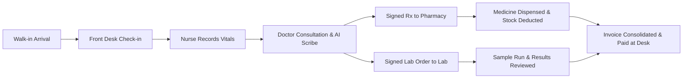

# Phase 6 — Operations

> **Goal:** Support end-to-end veterinary hospital floor operations, including front desk reception, waiting-room token displays, veterinary nurse triage, pharmacy dispensing, inventory replenishment, and diagnostics lab management.  
> **Estimated Duration:** 3–4 weeks (2–3 developers)  
> **Primary Outcome:** A unified clinic floor system where walk-in reception, nurse triage, consultation scribing, pharmacy dispensing, lab testing, and billing operate as a synchronized workflow.

---

## 1. Guiding Principles for Phase 6

1. **Connected Floor Workflow:** Patient movement from reception → triage → doctor → pharmacy/lab → billing must transition seamlessly in real-time.
2. **Stock Accountability:** Dispensing medications or medical supplies automatically tracks real-time inventory and updates patient billing.
3. **Structured Diagnostics Pipeline:** Lab orders advance through standard chain-of-custody stages (ordered, sampled, processed, reviewed, released).
4. **Layperson Diagnostic Clarity:** Lab test results include an AI-drafted, doctor-approved plain-language interpretation before releasing to pet owners.
5. **Operational Telemetry:** Track clinic throughput, documentation time saved, and AI modification rates to drive efficiency.

---

## 2. Database Schema

```sql
-- 1. Pharmacy & Inventory Management
CREATE TABLE inventory_items (
    id SERIAL PRIMARY KEY,
    clinic_id INT NOT NULL REFERENCES clinics(id) ON DELETE CASCADE,
    name VARCHAR(255) NOT NULL,
    sku VARCHAR(100),
    unit VARCHAR(50) DEFAULT 'tablets', -- tablets, ml, vials, doses, packs
    stock NUMERIC(10,2) NOT NULL DEFAULT 0.00,
    reorder_level NUMERIC(10,2) NOT NULL DEFAULT 10.00,
    cost NUMERIC(10,2) NOT NULL,
    price NUMERIC(10,2) NOT NULL,
    expiry DATE,
    created_at TIMESTAMPTZ DEFAULT NOW(),
    UNIQUE(clinic_id, sku)
);
CREATE INDEX idx_inventory_clinic_reorder ON inventory_items(clinic_id, stock, reorder_level);

CREATE TABLE stock_movements (
    id SERIAL PRIMARY KEY,
    item_id INT NOT NULL REFERENCES inventory_items(id) ON DELETE CASCADE,
    type VARCHAR(50) NOT NULL, -- 'purchase_order', 'dispense', 'adjustment', 'expired_write_off'
    qty NUMERIC(10,2) NOT NULL, -- positive for restock, negative for deduction
    ref_type VARCHAR(50),       -- 'prescription_dispense', 'manual_adjustment'
    ref_id INT,
    created_at TIMESTAMPTZ DEFAULT NOW()
);

CREATE TABLE dispensing (
    id SERIAL PRIMARY KEY,
    prescription_doc_id INT NOT NULL REFERENCES consultation_documents(id) ON DELETE CASCADE,
    item_id INT NOT NULL REFERENCES inventory_items(id),
    qty NUMERIC(10,2) NOT NULL,
    dispensed_by INT REFERENCES users(id),
    dispensed_at TIMESTAMPTZ DEFAULT NOW(),
    status VARCHAR(30) DEFAULT 'dispensed' -- pending, dispensed, out_of_stock
);

-- 2. Laboratory Orders & Results Pipeline
CREATE TABLE lab_orders (
    id SERIAL PRIMARY KEY,
    clinic_id INT NOT NULL REFERENCES clinics(id) ON DELETE CASCADE,
    consultation_id INT NOT NULL REFERENCES consultations(id) ON DELETE CASCADE,
    tests JSONB NOT NULL, -- e.g. ["Complete Blood Count (CBC)", "Serum Biochemistry Panel"]
    status VARCHAR(50) DEFAULT 'ordered', -- ordered, collected, sent_to_lab, resulted, reviewed, released
    external_lab_id VARCHAR(100),
    created_at TIMESTAMPTZ DEFAULT NOW()
);
CREATE INDEX idx_lab_orders_status ON lab_orders(clinic_id, status);

CREATE TABLE lab_samples (
    id SERIAL PRIMARY KEY,
    order_id INT NOT NULL REFERENCES lab_orders(id) ON DELETE CASCADE,
    barcode VARCHAR(100) UNIQUE NOT NULL,
    collected_at TIMESTAMPTZ,
    sent_at TIMESTAMPTZ,
    received_at TIMESTAMPTZ
);

CREATE TABLE lab_results (
    id SERIAL PRIMARY KEY,
    order_id INT NOT NULL REFERENCES lab_orders(id) ON DELETE CASCADE,
    values JSONB NOT NULL,       -- structured biomarker results
    file_key VARCHAR(255),       -- raw lab PDF/image report
    interpretation_md TEXT,      -- doctor-approved summary for owner
    reviewed_by INT REFERENCES users(id),
    released_at TIMESTAMPTZ,
    created_at TIMESTAMPTZ DEFAULT NOW()
);

-- 3. Multimedia Attachments
CREATE TABLE attachments (
    id UUID PRIMARY KEY DEFAULT gen_random_uuid(),
    clinic_id INT NOT NULL REFERENCES clinics(id) ON DELETE CASCADE,
    consultation_id INT NOT NULL REFERENCES consultations(id) ON DELETE CASCADE,
    file_name VARCHAR(255) NOT NULL,
    file_type VARCHAR(100) NOT NULL, -- image/png, application/pdf, etc.
    storage_key VARCHAR(255) NOT NULL,
    file_size_bytes INT NOT NULL,
    virus_scanned BOOLEAN DEFAULT FALSE,
    created_at TIMESTAMPTZ DEFAULT NOW()
);
```

---

## 3. Floor Operations Portals

### 3.1 Front Desk Receptionist Portal (`/desk`)
- **Walk-in Fast Registration:** Register new or returning owners & pets under 60 seconds with phone lookup.
- **Token Queue Management:**
  - Issue numbered tokens (e.g. `A-12`, `B-04`).
  - Broadcast live patient queue to waiting-room TV display monitor via WebSockets.
- **Vet Nurse Triage Mode:**
  - Dedicated mobile-friendly view for vet nurses to record baseline vitals (weight, temperature, heart rate, respiration rate) before the pet enters the doctor's room.
  - Recorded values automatically pre-populate the doctor's Consultation Summary draft.
- **Checkout & Receipt Counter:** Finalize invoices, apply walk-in counter payments, print thermal receipts.

### 3.2 Pharmacy & Dispensary Queue
- **Live Dispensing Queue:** Doctor-signed prescriptions instantly route to the pharmacy queue.
- **One-Click Dispense:**
  - Pharmacist marks items as dispensed.
  - Automatically updates `stock_movements` and decrements item inventory balance.
  - Automatically pushes dispensed medication costs to the consultation invoice.
- **Inventory Alerts:** In-app warnings and daily summary emails when stock falls below `reorder_level` or medicines approach expiration date.

### 3.3 Diagnostic Lab Workflow
1. **Order Creation:** Tests marked as **"Formally Ordered"** in the AI-generated Lab Tests document automatically create a `lab_orders` record.
2. **Sample Collection & Barcoding:** Phlebotomist/nurse collects sample, scans generated barcode label, sets status to `collected`.
3. **In-House or External Lab Routing:** Integrates with in-house analyzers (IDEXX/Heska) or external partner diagnostic labs.
4. **Doctor Review & Plain-Language Summary:**
   - Raw values and PDF report uploaded to `lab_results`.
   - LLM prepares an owner-friendly explanation draft (e.g., explaining elevated ALT/ALP in plain terms).
   - Doctor reviews, approves, and clicks **"Release to Owner"**, making it visible on the Owner Portal.

---

## 4. Clinic Operations & AI Performance Analytics

Admin & Practice Owner Analytics Dashboard:
- **Consultation Velocity:** Number of consultations per doctor per day.
- **Time Savings Metrics:** Average time saved per consult (measured against historical baseline).
- **AI Modification Rate (Edit Distance):** Quantitative tracking of text changes between AI draft and final doctor-approved version (highlighting accuracy improvements).
- **Top Diagnoses & Prescription Trends:** Frequency breakdown of presenting complaints, ICD/SNOMED equivalents, and top prescribed pharmaceuticals.
- **Revenue & No-Show Rate:** Breakdown of appointment cancellations, no-shows, consultation fees vs. pharmacy revenue.
- **Vaccine & Wellness Compliance:** Percentage of active clinic pets up-to-date with core vaccinations.

---

## 5. Medical Attachments Pipeline

- Doctors and staff can upload physical clinical photos (dermatology lesions, wound progression), digital X-rays (DICOM/JPEG), ultrasound clips, and past outside records.
- Files uploaded directly to secure S3-compatible buckets using pre-signed upload URLs.
- Asynchronous anti-virus scanning worker validates file safety before attachment is rendered viewable.

---

## 6. Exit Criteria

- [ ] Complete operational flow verified: Walk-in registered → Nurse records vitals → Doctor scribes & signs consultation → Pharmacy dispenses medication → Invoice auto-updated → Front desk collects payment.
- [ ] Dispensing prescription medication decrements pharmacy stock count in real-time.
- [ ] Lab test ordered during consultation progresses through full status chain (`ordered` → `collected` → `reviewed` → `released`).
- [ ] Analytics dashboard computes accurate consultation volume and AI edit rate metrics.



