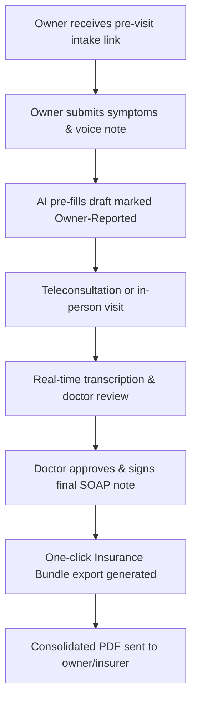

# Phase 7 — Advanced Capabilities & Telehealth

> **Goal:** Extend platform reach and clinic efficiency with remote veterinary telehealth, pre-visit smart intake, insurer claim bundling, asynchronous owner chat, and voice-driven document editing.  
> **Estimated Duration:** 4+ weeks (2–3 developers)  
> **Primary Outcome:** A comprehensive modern veterinary healthcare suite capable of virtual care delivery, seamless insurer data exchange, and AI-assisted clinical workflow acceleration.

---

## 1. Guiding Principles for Phase 7

1. **Clear Provenance of Intake Data:** Information submitted by owners prior to visits must be explicitly tagged as `"Owner-Reported"` until verified by the clinician.
2. **Teleconsultation Regulatory Compliance:** Virtual consults must enforce state/country veterinary-client-patient relationship (VCPR) legal requirements.
3. **Frictionless Insurance Claims:** Pet insurance processing should require zero manual collation by pet owners or clinic staff.
4. **Mobile First, Native Lean:** Optimize for Progressive Web Apps (PWA) with offline-first caching before considering separate native app store binaries.

---

## 2. Feature Specifications & Technical Workflows

### 2.1 Pre-Visit Smart Intake (Text & Voice Note)
- **Workflow:**
  1. 24 hours prior to scheduled appointment, owner receives intake prompt via SMS/WhatsApp.
  2. Owner completes structured intake web form or records a 60-second voice note detailing current symptoms, diet, and behavior changes.
  3. AI transcribes and processes intake information.
  4. Pre-populates the consultation's **Subjective / History** draft with a distinct badge: `"Owner-Reported Pre-Intake (Unverified)"`.
  5. Attending doctor quickly verifies or adjusts during physical examination.

### 2.2 Asynchronous Pet Chat & Messaging
- **Architecture:**
  - Secure threaded chat organized per pet (`chat_threads`, `chat_messages`).
  - Supports image and video attachments (e.g. surgical wound monitoring, gait video).
  - Configurable doctor response windows (e.g. `"Dr. Smith usually responds within 4 business hours"`).
  - Triage staff can assign incoming inquiries to nurses or doctors.
  - Option to convert an ongoing chat conversation directly into a billable Teleconsultation session.

### 2.3 Integrated Veterinary Teleconsultation
- **Video Infrastructure:** WebRTC video room integration (via Daily.co or Twilio Video SDK).
- **In-Call Audio Pipeline:**
  - Dual-channel audio stream (Doctor & Pet Owner).
  - Feeds directly into the existing real-time Whisper transcription and clinical AI extraction engine.
  - Generates the standard consultation summary, treatment plan, and e-prescription.
- **Jurisdiction & VCPR Validation:**
  - Enforces that telemedicine is only permitted if an established in-person VCPR exists within the statutory timeframe (e.g., in-person visit within the past 12 months), unless permitted for triage-only consults.

### 2.4 One-Click Insurance Claim Export
- **Export Bundle Generator:**
  - Bundles:
    1. Attending Doctor's Official Signed SOAP Visit Summary.
    2. Itemized GST Tax Invoice with proof of payment.
    3. Diagnostic Lab Results, Biopsy Reports, and Imaging Notes.
    4. Attending Doctor's Veterinary License Number & Practice Seal.
  - Generates a consolidated, indexed PDF package compliant with major pet insurance carriers (Petplan, Trupanion, Nationwide, Bajaj Allianz, etc.).
  - Includes a direct secure link for the insurer's adjudicator to verify document integrity against the blockchain-style ledger.

### 2.5 Health Records Vault & Vet-to-Vet Share
- **Owner Vault:** Pet owners can scan and upload historical records, vaccination cards from previous clinics, and external ultrasound/X-ray files.
- **Expiring Referral Link:**
  - Generating a temporary (24–72 hour) encrypted web link.
  - Allows an external specialist or emergency hospital to view the pet's complete medical history and longitudinal vitals without requiring an account.

### 2.6 Voice Dictation Document Editing
- Real-time voice microphone inside the consultation editor:
  - Doctor holds hotkey (or clicks mic) and speaks: `"Add cephalexin 500mg twice daily for 10 days"`.
  - Speech-to-text translates instruction into structured patch command.
  - AI inserts the medication directly into the Prescription table without manual typing.

### 2.7 Mobile Strategy: High-Performance PWA
- Progressive Web App with service workers for caching shell assets.
- Responsive mobile layouts tailored for single-hand mobile use by owners and on-the-go doctors.
- Web Push Notifications for appointment reminders, dose schedule alerts, and chat messages.

---

## 3. Database Schema Extensions

```sql
-- 1. Pre-Visit Intake Submissions
CREATE TABLE pre_visit_intakes (
    id SERIAL PRIMARY KEY,
    clinic_id INT NOT NULL REFERENCES clinics(id) ON DELETE CASCADE,
    appointment_id INT UNIQUE NOT NULL REFERENCES appointments(id) ON DELETE CASCADE,
    owner_id INT NOT NULL REFERENCES owners(id),
    pet_id INT NOT NULL REFERENCES pets(id),
    symptoms_text TEXT,
    voice_audio_key VARCHAR(255),
    diet_notes TEXT,
    medication_changes TEXT,
    ai_extracted_summary JSONB,
    reviewed_by_doctor BOOLEAN DEFAULT FALSE,
    created_at TIMESTAMPTZ DEFAULT NOW()
);

-- 2. Async Clinic-Owner Chat Threads
CREATE TABLE chat_threads (
    id UUID PRIMARY KEY DEFAULT gen_random_uuid(),
    clinic_id INT NOT NULL REFERENCES clinics(id) ON DELETE CASCADE,
    owner_id INT NOT NULL REFERENCES owners(id) ON DELETE CASCADE,
    pet_id INT NOT NULL REFERENCES pets(id) ON DELETE CASCADE,
    assigned_user_id INT REFERENCES users(id),
    status VARCHAR(30) DEFAULT 'open', -- open, pending_owner, resolved, archived
    last_message_at TIMESTAMPTZ DEFAULT NOW()
);

CREATE TABLE chat_messages (
    id UUID PRIMARY KEY DEFAULT gen_random_uuid(),
    thread_id UUID NOT NULL REFERENCES chat_threads(id) ON DELETE CASCADE,
    sender_type VARCHAR(20) NOT NULL, -- 'user' (clinic staff) or 'owner'
    sender_id INT NOT NULL,
    message_text TEXT NOT NULL,
    attachment_keys TEXT[],
    read_at TIMESTAMPTZ,
    created_at TIMESTAMPTZ DEFAULT NOW()
);

-- 3. Teleconsultation Virtual Rooms
CREATE TABLE teleconsult_sessions (
    id UUID PRIMARY KEY DEFAULT gen_random_uuid(),
    consultation_id INT UNIQUE NOT NULL REFERENCES consultations(id) ON DELETE CASCADE,
    room_url VARCHAR(255) NOT NULL,
    room_token VARCHAR(255),
    vcpr_verified BOOLEAN DEFAULT FALSE,
    recording_started_at TIMESTAMPTZ,
    recording_ended_at TIMESTAMPTZ,
    status VARCHAR(30) DEFAULT 'scheduled' -- scheduled, in_progress, completed, failed
);
```

---

## 4. Exit Criteria

- [ ] Pet owner submits pre-visit intake voice note/form; doctor sees pre-populated and tagged clinical draft.
- [ ] Teleconsultation session launches WebRTC video call with audio streamed live into Whisper transcription pipeline.
- [ ] Insurance claim export packages SOAP summary, tax invoice, and lab reports into a single consolidated PDF.
- [ ] Vet-to-vet share link grants temporary read-only access to outside veterinarian and expires automatically.
- [ ] Voice dictation allows doctor to update prescriptions and notes hands-free.



